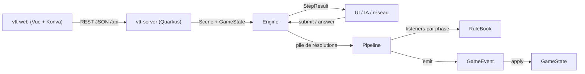

# Architecture

## Stack

- Java avec Maven. Les moteurs n'ont aucune dépendance runtime : ils doivent rester embarquables n'importe où (serveur web, client, outils).
- Modules Maven : `vtt-engine` (moteur générique `solovtt.engine` et scène générique `solovtt.scene`), `dnd-engine` (règles D&D 2024, qui en dépend) et `vtt-server` (Quarkus, REST JSON, qui embarque les moteurs). Un nouveau système de jeu est un module de plus qui dépend de `vtt-engine`. `vtt-module-api` (`solovtt.module`, interfaces seules, sans dépendance) décrit ce que le cœur offre à un module.
- Client web `vtt-web` (Vue 3, TypeScript, Vite), hors réacteur Maven. La carte est rendue par Konva dans `src/map/`, sans dépendance à Vue.
- Records, sealed interfaces et pattern matching sur `switch` sont utilisés partout ; ils structurent le moteur.

## Comment ça s'articule

## Décisions clés

- Tout est listener, même les règles de base (`CoreAttackRules`) : ajouter un sort, un don ou une capacité = écrire un listener et l'enregistrer dans `StandardRules`, sans toucher au moteur.
- Une réaction n'est pas un listener mais une `Reaction<T>`, enregistrée auprès de la fenêtre de son déclencheur (`AttackHitReactions` pour une attaque qui touche). La fenêtre empile une `ReactionWindow` qui pose une seule question par créature, avec toutes ses réactions possibles plus « Ne rien faire » : la cible d'abord, puis les autres créatures. Une nouvelle réaction (Contresort) s'ajoute à la fenêtre de son déclencheur, sans nouvelle question.
- Un ordre imposé par les règles devient une phase distincte, jamais une priorité. `Listener.priority()` ne départage qu'une même phase (plus petit = plus tôt, puis ordre d'enregistrement).
- Accumuler puis résoudre : pendant `MODIFY_ROLL`, avantages, désavantages et dés bonus s'empilent dans `AttackContext` ; `ROLL` les résout une seule fois.
- Le moteur est générique sur l'état `S` et l'événement `E extends Event<S>` (`Engine<S, E>`, `Listener<S, E, P, C>`…) ; il ne connaît aucun type de jeu. Côté D&D, `S = GameState` et `E = GameEvent`, et `AttackRule` évite de répéter les quatre paramètres.
- L'état ne change que via `Engine.emit(E)`. Chaque événement sait s'appliquer à l'état ; les jets de dés sont aussi des événements. Rejouer le journal redonne l'état final.
- Le moteur ne bloque jamais de thread : un listener retourne une `Decision`, le pipeline garde son curseur (phase + index) et `Engine` rend `StepResult.AwaitingDecision`.
- Un effet peut empiler sa propre résolution (`Engine.push`) : elle se résout entièrement avant que celle du dessous reprenne.
- Le hasard est injecté (`Dice`) ; le moteur n'appelle jamais `Random` directement.
- L'enchaînement des tours est générique, l'initiative est D&D. `vtt-engine` décrit un tour par `TurnOrder` (round, candidats qui peuvent jouer, créature active) ; la `TurnPolicy<S>` du système rend les candidats au début puis après chaque fin de tour. Un seul candidat devient actif d'office ; plusieurs (ex æquo D&D, « les joueurs » de Daggerheart) font poser « Qui joue ? ».
- Côté D&D (`dnd.engine.combat`), `InitiativePolicy` range les créatures en groupes d'initiative : total décroissant, puis modificateur ; à égalité complète, un groupe dont chaque membre joue une fois par round, dans l'ordre que choisit le joueur. Lancement, fin de tour, arrivée, départ et fin du combat sont des `Resolution` simples (`StartCombat`, `EndTurn`, `JoinCombat`, `LeaveCombat`, `EndCombat`) dont les événements placent l'état : le combat se rejoue. Le joueur termine le combat quand il veut (`CombatEnded`) : plus d'ordre ni de tour, les créatures gardent PV, réaction et effets. Au début de son tour, une créature récupère sa réaction.
- Seule une créature qui peut agir attaque : `AttackAction.refusal` refuse une créature à 0 PV (inconsciente) et, en combat, toute autre que l'active ; `AttackAction.of` lève la raison (400). La feuille porte la même raison (`attackRefusal`) : le client ferme les boutons sans connaître la règle. Le tour d'une créature à terre s'ouvre quand même. Une créature posée tire son initiative et joue ce round-ci si son rang vient après le groupe en cours, sinon au suivant ; une créature retirée quitte l'ordre, et si elle jouait, le tour suivant s'ouvre.
- La carte est générique (`solovtt.scene.Scene`) : elle ne connaît que des positions et des distances réelles, euclidiennes de centre à centre, dans son unité (mètres ou pieds). Chaque système décide de leur usage ; un jeton ne référence son entité que par `entityId`.
- Le serveur tient une `SceneSession` par campagne, en mémoire, qui compose la `Scene`, le `GameState` et un `Engine` par carte. La préparation de scène construit l'état initial hors journal ; les actions passent par le moteur, et chaque événement est décrit dans le journal au moment où il est émis. Les dés viennent d'un bean `Dice` (`DiceProducer`, remplaçable en test). Le moteur reçoit `StandardRules.create()` tel quel.
- La campagne est l'unité de la partie : toute route d'une partie est sous `/api/campaigns/{id}/…` (`scene`, `catalog`, `maps`, `creatures`, `attacks`, `journal`, `decisions`, `combat`, `combats`, `notebook`, `modules`, et celles des modules actifs) ; seuls `campaigns`, `images` et `modules` (les modules installés) sont communs. `CampaignResource` sert ces routes par des localisateurs de sous-ressources qui construisent `SceneResource`, `MapResource`… sur la session de la campagne. Le registre `CampaignSessions` crée la session d'une campagne à sa première demande, en rejouant sa partie, puis la garde jusqu'à l'arrêt du serveur ; un id inconnu rend 404. Deux campagnes jouent donc côte à côte, et un redémarrage est invisible au client. Le port `CampaignStore` (`list`, `create`, `find`, `games`, `maps`, `notebook`) liste et crée les campagnes (un nom seul, doublons permis) et donne le `GameStore` et le `MapStore` de chacune ; les images restent communes. L'adaptateur `persistence.FileCampaignStore` garde chaque campagne dans `solovtt.campaigns.path/<uuid>/` (par défaut `~/.solo-vtt/campagnes`) : `campagne.json` (id, nom), `partie.json` (`JsonFileGameStore`), `cartes.json` (`JsonFileMapStore`) ; un dossier sans fiche lisible est ignoré, jamais écrasé ; mémoire en test. Les constructeurs de test `SceneSession(Dice)` et `SceneSession(Dice, GameStore)` gardent leurs cartes enregistrées en mémoire.
- La partie se garde par ses commandes, derrière le port `GameStore` (`load`, `save`, `setAside`) : chaque appel réussi de `SceneSession` qui la modifie (carte, pose, retrait, déplacement, attaque, combat, réponse) entre dans une `SavedGame` avec les dés tirés pendant l'appel, puis est sauvé ; une commande refusée n'y entre pas, « nouvelle carte » la remet à zéro. À l'ouverture de la campagne, la session rejoue ces commandes avec ces dés : scène, état, journal et décision en attente reviennent à l'identique, sans sérialiser l'état ni la lambda de la décision. L'adaptateur `persistence.JsonFileGameStore` porte Jackson et le disque (`partie.json` de la campagne, écriture atomique) ; le profil de test n'a pas de fichier.
- Les images de fond des cartes vivent hors de la partie, derrière le port `ImageStore` : chacune est gardée une seule fois sous l'empreinte SHA-256 de ses octets, que la partie référence. `POST /api/images` reçoit les octets bruts (PNG, JPEG ou WebP, signature vérifiée, 415 pour un autre type), `GET /api/images/{id}` les relit, en cache immuable. L'adaptateur `persistence.FileImageStore` écrit `<empreinte>.<ext>` dans `solovtt.images.path` (par défaut `~/.solo-vtt/images`) ; le profil de test les garde en mémoire. Aucune image n'est jamais supprimée. Le corps d'une requête est limité à 50 Mo (`quarkus.http.limits.max-body-size`).
- L'image de fond et l'affichage de la grille appartiennent à la carte de `SceneSession`, pas à `solovtt.scene.Scene` : aucune règle n'en dépend. La commande `Create` garde l'empreinte de l'image (refusée en 400 si inconnue à la création), `ShowGrid` le choix de grille (`PUT /api/scene/grid`), permis en combat et pendant une décision, car c'est de l'affichage. Une nouvelle carte affiche sa grille. Côté client, la carte tire ses dimensions de l'image (`map/backdrop.ts`) : cases = largeur en pixels / taille de case en pixels, chaque case valant 1,5 m ou 5 ft ; l'image est étirée sur toute la carte, dont l'origine est le coin haut gauche de l'image. Le client refuse une image de plus de 50 Mo avant l'envoi : au-delà, le serveur coupe la connexion et le navigateur ne verrait qu'une erreur réseau.
- Caler la grille sur l'image (`PUT /api/scene/alignment`, commande `AlignGrid`) : la grille part d'un décalage gardé par `SceneSession` en fraction de case, dans [0, 1) (`gridOffsetX`, `gridOffsetY`), pour que le serveur ignore la taille d'une case ; il ne sert qu'à l'affichage et au calage côté client. Changer la taille de case change les dimensions de la carte : la `Scene` est remplacée par `Scene.rescaled(nouvelle largeur / ancienne)`, qui multiplie dimensions et positions, donc chaque créature reste au même endroit de l'image. Largeur et hauteur doivent changer d'échelle ensemble (cases carrées, 400 sinon). Refusé (409) en combat, car la vitesse dépensée ne se remet pas à l'échelle, pendant une décision et sur une carte sans image ; permis après « Terminer le combat ».
- Une carte enregistrée (`SavedMap`) est un modèle de départ, pas une partie : dimensions, unité, image, grille, et l'entrée du catalogue et la position de chaque créature, dans l'ordre de pose ; ni PV, ni effets, ni combat, ni journal. Elles vivent derrière le port `MapStore` (adaptateur `persistence.JsonFileMapStore`, toutes dans le `cartes.json` de la campagne, écriture atomique, fichier illisible jamais écrasé ; mémoire en test), une liste par campagne, par nom : enregistrer sous un nom pris remplace la carte. `POST /api/maps` tire la carte en cours (`SceneSession.snapshot`) sans toucher la partie ; `POST /api/maps/load` la recharge (`SceneSession.load`) comme une nouvelle carte, permis en combat et pendant une décision : la partie la copie en commandes ordinaires (`Create`, `ShowGrid`, `Place`), jamais en référence, et n'en garde le nom qu'à titre d'information (`Create.mapName`, `SceneDto.mapName`). Une créature sortie du catalogue refuse le chargement (409) avant tout changement. Un personnage joueur y est gardé par l'id de sa page : le charger reprend une copie fraîche de sa fiche (409 si elle est supprimée ou si D&D est inactif, 400 si elle ne peut pas jouer).
- Un combat est un agrégat, de « Lancer le combat » à « Terminer le combat » : la partie (`SavedGame`) de la création de sa carte à sa fin, derrière le port `CombatStore` (`game(combatId)`, `ids()` ; `CampaignStore.combats`), que l'adaptateur `persistence.JsonFileCombatStore` écrit dans `<campagne>/combats/<combatId>.json` (format de `JsonFileGameStore` ; id UUID vérifié ; mémoire en test). `SavedCommand.StartCombat` porte `combatId` (`null` dans une partie d'avant : le combat n'est gardé que dans la partie) ; `SceneSession` tient le combat en cours et, à chaque commande gardée hors rejeu, écrit aussi son fichier ; `EndCombat` l'écrit puis le fige ; « Nouvelle carte » et « Charger une carte » oublient le combat en cours avant d'écrire, si bien qu'il reste en cours, intact ; un lancement refusé ne change rien. Plusieurs combats peuvent donc être en cours à la fois, un seul étant la partie de la carte. Le combat ignore le Carnet : son entrée est une `Page` qui le référence (`Page.combatId`, son propre id), sans texte (`saveContent` 400) ni sous-page (`create`, `move` sous elle : 400), rangée sous la racine de section `combats` « Combats » que tient le cœur (`NotebookStore.createCombatEntry`, racine créée au premier combat) ; le nom du combat est le titre de l'entrée (« Combat N », N le nombre de combats gardés), qui se renomme, se déplace, va à la corbeille et en revient comme une page ; `[[` la propose, la recherche la trouve par son titre. Vider la corbeille n'efface pas le fichier du combat. `CampaignSessions` passe à la session un rappel `combatStarted`, appelé après un lancement réussi hors rejeu, qui crée l'entrée ; son échec est journalisé sans défaire le lancement, déjà gardé. Un fichier de combat qui ne se lit pas rend 409, comme un combat qui ne se rejoue plus. `CombatsResource` (`/api/campaigns/{id}/combats`) : `GET /{combatId}` rend `ended`, `current` (la partie de la carte en cours) et la carte telle qu'il l'a laissée, en rejouant son fichier (`SceneSession.replayed`, sans store ni rappel) ; `POST /{combatId}/resume` reprend un combat en cours qui n'est pas la partie courante : il est d'abord rejoué à part (409 s'il est illisible ou terminé, la partie courante intacte), puis remplace la partie (`SceneSession.resume`), sans confirmation, comme « Nouvelle carte » ; `GET /{combatId}/replay` (409 pour un combat en cours) rend tous les pas d'un combat terminé en une réponse (`CombatReplay`) : pas 0, le départ, l'état juste avant le lancement ; puis un pas se ferme après une commande qui écrit au journal sans laisser de décision en attente (lancement et « Qui joue ? », attaque et réaction, déplacement de l'active, fin de tour, pose, retrait, fin) ; une commande muette (repositionnement libre) rejoint le pas suivant. Chaque pas porte ses entrées, la cible d'une attaque et ses PV, la carte, le combat et les feuilles. Un combat qui ne se rejoue plus (règles changées) est illisible : 409, le Carnet le dit.
- Côté client, ouvrir une entrée de combat (arbre, lien, onglet, recherche) montre à la place de l'éditeur `CombatEntryView` : l'état, la carte en petit (`CombatThumbnail`, SVG de l'image et des pastilles, sans Konva) et un bouton ; un combat terminé s'ouvre en rejeu (`/campagnes/<id>/combats/<combatId>/rejeu`, `ReplayScreen`), un combat en cours sur l'écran de combat, repris d'abord s'il n'est pas la partie courante. `visiblePages` montre toujours la section `combats`, titrée « Combats » par `PageTree` ; `canMove` refuse une entrée de combat comme parent, `PageBranch` lui retire « Nouvelle sous-page ». `ReplayScreen` est un écran à part, sans requête qui modifie la partie : la même table qu'en direct (`TokenBoard` en `readonly`, `MapView` sans glisser, feuilles sans attaque, journal jusqu'au pas, piste à dés), ouvert sur l'état final ; pas avant : la carte du pas, puis les dés de l'attaque (`dice/tray.ts`, `throwsOf` et `trayFromJournal`, partagés avec `GameScreen`), les PV de la cible baissant à l'arrêt ; pas arrière, début et fin posent l'état d'emblée ; lecture : un pas, puis deux secondes après la fin de son animation le suivant, jusqu'à la fin ; tout geste met en pause ; clavier ←, →, Début, Fin, Espace. Un geste plus récent rend caduque l'animation en cours (numéro de geste).
- Le Carnet d'une campagne vit hors de la partie, derrière le port `NotebookStore` (`list`, `find`, `create`, `saveContent`, `rename`, `move`, `delete`, `trash`, `restore`, `emptyTrash`, `tabs`, `setTabs`) que donne `CampaignStore.notebook` : des pages (`Page` : id UUID, titre, parent, contenu) et ses onglets (`Tabs` : les pages ouvertes, dans l'ordre, et l'active), gardés par le serveur pour survivre à un redémarrage. `PUT …/notebook/tabs` les remplace en entier : page inconnue 404 ; doublon, ou actif qui n'est pas l'un des onglets (`null` si et seulement si aucun onglet) 400. `GET …/notebook` omet un onglet dont la page n'existe plus, et l'actif avec. Le contenu est le document JSON de l'éditeur (Tiptap), que le serveur garde sans l'interpréter : il vérifie seulement `type: "doc"` (400 sinon). `NotebookResource` (`/api/campaigns/{id}/notebook`) est construit sur le `CampaignStore`, sans `CampaignSessions` : lire le Carnet ne rejoue pas la partie. Page inconnue : `NotFoundException` levée par la ressource (404), car `ErrorMapper` rend 400 pour une `IllegalArgumentException`. L'adaptateur `persistence.JsonFileNotebookStore` écrit dans `<campagne>/carnet/` une fiche par page (`<id>.json`, contenu en JSON imbriqué) et `carnet.json` (`openPageIds` dans l'ordre, `lastPageId` l'onglet actif ; un fichier d'avant les onglets, sans `openPageIds`, se lit en un seul onglet), atomiquement ; une fiche illisible est ignorée, jamais écrasée ; `FileCampaignStore` garde un seul Carnet par campagne. Une base de données remplacera ce port le jour où l'application sera hébergée. L'arbre du Carnet n'est que le `parentId` de chaque page (`null` à la racine), sans ordre stocké : déplacer une page (`PUT …/pages/{id}/parent`) ne réécrit que sa fiche, et ses sous-pages suivent ; renommer passe par `PUT …/pages/{id}/title`, avec le même nettoyage de titre que la création. Le port refuse, sous son verrou, un parent qui serait la page ou l'une de ses sous-pages (`PageTree.isWithin`, 400) ; un parent inconnu rend 404. `GET …/notebook` passe la liste par `PageTree.rooted` : une page dont le parent est illisible, ou qui boucle sur elle-même (fiche éditée à la main), y est rendue à la racine, sans que sa fiche soit réécrite ; une fiche d'avant l'arbre, sans `parentId`, se lit à la racine. Supprimer une page (`DELETE …/pages/{id}`) la met à la corbeille avec ses sous-pages vivantes, en un lot : chaque fiche reste en place, marquée `deletedWith` (la page supprimée) et `deletedAt` (ISO-8601, le mapper n'a pas de module `java.time`) ; `list` et `find` ne voient plus que les pages vivantes, si bien que contenu, titre, parent, sous-page et onglet d'une page à la corbeille rendent 404, et que liens entrants, recherche et onglets l'ignorent. `GET …/pages/{id}/deletion` dit, avant la confirmation, ses sous-pages et les pages hors du lot qui lient l'une d'elles (`PageTree.branch`, `PageLinks.citingAny`). `GET …/notebook/trash` liste les suppressions, une par lot, la plus récente d'abord ; `POST …/trash/{id}/restore` démarque le lot (404 si `id` n'en est pas un) : la page reprend son parent s'il est vivant, sinon la racine, ses sous-pages le leur. Une sous-page supprimée avant son parent reste son propre lot. `DELETE …/notebook/trash` efface les fiches marquées, jamais une illisible, et aucune image.
- Ouvrir une campagne mène à son Carnet (`NotebookScreen`), sur ses onglets et l'actif, sinon le premier onglet ; sans onglet, « Aucune page ouverte. », même au retour du combat ; sans page, une invitation à créer la première ; « Combat » ouvre l'écran de jeu (`GameScreen`), dont le bouton Carnet ramène. Chaque écran a son adresse (`vue-router`, `src/router.ts`, `createWebHistory`) : `/` l'accueil, `/campagnes/<id>/carnet/<pageId>` le Carnet sur une page (sans `pageId` : aucune page ouverte), `/campagnes/<id>/combat` le combat, `/campagnes/<id>/combats/<combatId>/rejeu` le rejeu d'un combat terminé ; toute autre adresse redirige vers `/`. Avant d'entrer sur une route de campagne, `router.beforeEach` la cherche dans `GET /api/campaigns` (gardée ensuite en mémoire, une campagne n'étant jamais supprimée) ; inconnue ou serveur injoignable : l'accueil. `App.vue` rend l'écran de la route (`RouterView`), avec une `key` par écran et campagne : changer de page garde le Carnet monté, changer d'écran le remonte, et chacun relit la campagne au serveur en se montant, rien n'est gardé côté client entre deux écrans. Dans le Carnet, l'adresse fait foi : un geste qui ouvre une page (arbre, lien, onglet, recherche, citante) navigue (`router.push`), et la page s'ouvre quand `pageId` change, si bien que Précédent et Suivant suivent le même chemin ; créer une page pousse aussi une entrée ; l'ouverture d'arrivée, la fermeture d'un onglet ou une suppression qui change la page active remplacent l'entrée (`writeAddress`). À l'arrivée, la page de l'adresse passe avant l'onglet actif ; illisible (inconnue, à la corbeille), le Carnet s'ouvre comme sans page et l'adresse est remplacée, sans bandeau. Les gardes `onBeforeRouteUpdate` et `onBeforeRouteLeave` attendent le geste en cours puis `saved()` : un échec annule la navigation, et `vue-router` remet l'adresse d'un Précédent refusé (`history.go`) ; une navigation lancée par le Carnet lui-même ne passe pas par elles (`writing`), sinon elle attendrait le geste dont elle fait partie. Toute ouverture d'une page (arbre, lien, résultat de recherche, page citante, création) l'ajoute en onglet, en fin de barre (`PageTabs`), ou active le sien, puis envoie tous les onglets (`PUT …/notebook/tabs`) ; un échec de cet envoi va au bandeau sans fermer la page. Un seul éditeur est monté, celui de l'onglet actif : activer un onglet relit sa page au serveur et la rouvre verrouillée, sans l'annulation ni le défilement d'avant. Fermer l'onglet actif attend l'envoi de la frappe (refus : rien ne ferme), puis active le voisin de droite, sinon de gauche ; sans onglet, « Aucune page ouverte. ». Fermé au clavier, le focus passe à l'onglet actif. Les titres des onglets viennent de la liste des pages : un renommage s'y voit aussitôt. Les onglets se réordonnent par glisser-déposer (événements pointeur, souris et stylet, défilement automatique près des bords) ou par Ctrl+Maj+← / → : `PageTabs` émet le nouvel ordre, que `NotebookScreen` envoie en entier (`PUT …/notebook/tabs`), comme à chaque ouverture. Les pages s'affichent en arbre (`PageTree`, rendu récursif par `PageBranch`), que le client tire de la liste plate (`notebook/tree.ts`) : sœurs triées par titre en ordre numérique (`Intl.Collator`, `numeric`), « Session 2 » avant « Session 10 », sans ordre manuel. Les branches dépliées vivent dans `NotebookScreen` seulement : à l'ouverture, à la création et au déplacement d'une page, ses ancêtres se déplient ; au retour du combat, seul ce chemin l'est. Chaque ligne a un menu (Nouvelle sous-page, Renommer, Déplacer sous…, Supprimer…) ; renommer et créer ouvrent un champ dans l'arbre, Déplacer ouvre `MovePageDialog`, qui montre toutes les pages et éteint la page, ses sous-pages et sa place actuelle (`canMove`). Supprimer ouvre `DeletePageDialog`, qui lit `…/deletion` et dit les sous-pages et les pages qui y renvoient, focus sur Annuler ; confirmer envoie d'abord la frappe en attente si la page ouverte est du lot (échec : rien n'est supprimé), puis supprime, relit le Carnet et ferme les onglets du lot (`closeTabs`, voisin de droite de l'actif parmi ceux qui restent, sinon de gauche). Le bouton Corbeille, au pied du panneau Pages et dans un Carnet vide, ouvre `TrashDialog` : restaurer relit le Carnet et déplie le chemin de la page ; « Vider » se confirme sur place. Un échec ferme le dialogue, dont le modal cacherait le bandeau. Les liens vers une page supprimée meurent et revivent d'eux-mêmes, puisqu'ils lisent la liste des pages. À la souris et au stylet, `PageTree` déplace aussi par glisser-déposer, en événements pointeur (au-delà de 6 px, cible par `document.elementFromPoint`, mêmes refus par `canMove`, sans requête), vers une ligne ou la zone « Racine du Carnet » ; le toucher ne glisse pas et garde le menu, comme le clavier. Le titre d'une ligne est un `<a href>` vers l'adresse de la page (`draggable="false"`, sinon le glisser natif du lien gênerait celui de l'arbre) : tout clic au bouton principal, Ctrl+clic compris, l'ouvre dans l'application ; le clic du milieu (`auxclick`, jamais intercepté) est laissé au navigateur, qui l'ouvre dans un nouvel onglet. Une page déverrouillée se renomme aussi par son titre, qui devient un champ de même allure. Après chaque geste, le Carnet relit l'arbre au serveur, refus compris. Le corps d'une page est un éditeur Tiptap 3 (`PageEditor`, StarterKit sans `link`), un par page (`:key`) pour que l'annulation ne passe pas d'une page à l'autre. Le verrou est purement client : une page s'ouvre verrouillée, sauf celle qu'on vient de créer ; verrouillée, l'éditeur n'est pas éditable : ProseMirror n'exécute alors ni touches, ni collage, ni dépôt (ses `editorProps` ne sont qu'une garde). L'enregistrement est automatique : envoi du document entier une seconde après la dernière frappe, un envoi à la fois ; avant d'ouvrir une autre page, de créer ou de quitter l'écran, le Carnet attend l'envoi et reste sur place s'il échoue (erreur affichée, contenu gardé et renvoyé au changement suivant) ; `visibilitychange` vers `hidden` envoie aussi, et `pagehide` renvoie en `keepalive` sous 60 Ko.
- Une image dans une page du Carnet est un nœud Tiptap bloc, atomique, `pageImage { imageId, alt }` (`notebook/pageImage.ts`) : le document garde l'empreinte de l'image, jamais son adresse, et `alt` le nom du fichier, affiché si l'image ne se lit plus. Les images des pages vivent dans le même `ImageStore` que les fonds de carte (`POST /api/images`), communes à toutes les campagnes ; ni les liens entrants ni la recherche ne lisent ce nœud. Page déverrouillée, le bouton Image de la tête de page choisit un fichier ; `PageEditor.insertImage` le refuse avant l'envoi (`src/images.ts`, `imageRefusal` : PNG, JPEG ou WebP, 50 Mo au plus, mêmes règles que la carte), sinon l'envoie puis l'insère au curseur en une seule commande, que Ctrl+Z défait ; la raison d'un refus va au bandeau d'erreur. En écriture, des fichiers déposés ou collés sur le texte (`handleDrop`, `handlePaste`) entrent de même, dans l'ordre, le premier au point de dépôt ; un collage sans fichier ne change pas. Verrouillée, ProseMirror n'appelle pas ces gestionnaires : `NotebookScreen` empêche alors, comme partout hors du texte éditable, qu'un fichier lâché soit ouvert par le navigateur à la place de l'application (`dropEffect` `none`). Le curseur passe ensuite dans le texte voisin, sinon l'image suivante remplacerait celle qu'on vient de poser. Retirer une image de la page (sélection puis Retour arrière) ne supprime rien sur le serveur : Ctrl+Z la remet sans nouvel envoi.
- Un lien entre pages du Carnet est un nœud Tiptap en ligne, atomique, `pageLink { pageId, label }` (`notebook/pageLink.ts`) : le titre de la cible n'est jamais stocké, `label` est le texte choisi (`null` : le titre). Le lien lit à l'affichage la liste des pages que `NotebookScreen` relit à chaque geste ; renommer ou déplacer la cible ne réécrit donc aucune page, et une cible absente de la liste donne un lien mort (« page introuvable » sans `label`), qui n'ouvre rien. Ce format est le contrat que liront les liens entrants et la corbeille ; le serveur ne le valide jamais à l'enregistrement, mais le lit pour les liens entrants : `GET …/notebook/pages/{id}/citing` (`PageLinks.citing`) parcourt à chaque appel le contenu de toutes les pages, sans index, et rend celles qui ont un nœud `pageLink` vers la page, triées par titre, sans la page elle-même ; un contenu illisible est sauté. Le client (`CitingPages`, sous le texte) la relit à l'ouverture de la page seulement : un lien s'ajoute ou se retire dans une autre page, donc avant de rouvrir celle-ci (`open` attend l'enregistrement) ; il ne garde que les ids et tire les titres de la liste des pages, si bien qu'un renommage s'y voit aussitôt. Un échec de lecture laisse la page ouverte, sans liste, l'erreur dans le bandeau. Taper `[[` ouvre la liste des pages (`@tiptap/suggestion`, `PageLinkList`), filtrée sur le titre sans casse ni accents ; insérer est une seule commande, que Ctrl+Z défait. Page verrouillée, un clic ou Entrée sur le lien (`<a href>`, atteignable au Tab) ouvre la cible par `NotebookScreen.open`, qui attend l'enregistrement ; en écriture, un clic ou les flèches le sélectionnent (`NodeSelection`) et montrent sa bulle (`PageLinkBubble`, `BubbleMenu` de Tiptap) : « Ouvrir » et « Texte affiché », posé en un seul pas d'annulation ; Ctrl+clic l'ouvre. Le lien porte l'adresse de sa cible (option `pageHref`) : le clic du milieu l'ouvre dans un nouvel onglet du navigateur, verrouillé ou non ; `PageLinkView` arrête alors `mousedown` et `mouseup` au bouton du milieu, que ProseMirror prendrait sinon pour sélectionner le lien en écriture ; un lien mort n'a pas d'adresse. En écriture, le lien sort de l'ordre du Tab (`tabindex=-1`), et le cadre de la bulle aussi, que Tiptap rend focusable. La liste des pages et l'état du verrou passent à l'extension par des fonctions (`pages`, `locked`), jamais une `Ref` : Tiptap copie les options en profondeur et perdrait sa valeur.
- La recherche du Carnet est une boîte noire du port `NotebookStore`, comme sa persistance : `search(query)` rend les pages dont le titre ou le texte contient chaque mot, sans casse ni accents, celles au titre trouvé d'abord, chacune avec un extrait déjà découpé en morceaux (`Fragment { text, match }`) ; `GET …/notebook/search?q=` (400 sans mot) ne connaît que ce contrat, et le client affiche les morceaux sans rien replier. L'implémentation par défaut (`PageSearch`, méthode `default` héritée par `inMemory` et `JsonFileNotebookStore`) relit `list()` à chaque appel, sans index : le texte d'une page est la suite de ses nœuds `text` et du texte affiché de ses liens (`label`, sinon le titre de la cible), un espace entre deux blocs ; titre et texte sont pliés caractère par caractère (NFD sans `\p{M}`, minuscule), ce qui garde les positions ; l'extrait part du premier mot trouvé dans le texte (40 caractères avant, 80 après, coupé aux espaces, « … » aux bords), sinon du début du texte (120 caractères) ; un contenu illisible est cherché sur son titre seul. Un adaptateur à index ou une base la remplace sans toucher la ressource ni le client. Côté client, le champ « Chercher » du panneau Pages lance la recherche 250 ms après la dernière frappe, après avoir envoyé la frappe en attente de la page ouverte (`saved`, sinon rien ne part) ; un numéro de recherche ignore une réponse périmée ; tant que le champ n'est pas vide, `SearchResults` remplace l'arbre, qui revient tel qu'il était déplié quand on le vide (Échap, « Effacer ») ; ouvrir un résultat passe par `open` et garde la liste.
- Une décision du moteur (réaction Bouclier, « Qui joue ? ») suspend l'action : la session la garde avec la cible de l'action (aucune pour le combat), `/api/decisions` la relit et y répond, et l'action reprend sous le même numéro dans le journal. Tant qu'elle attend, attaque, pose, retrait, lancement du combat, fin de tour et fin du combat sont refusés (`DecisionPendingException`, 409) ; « nouvelle carte » reste permise et quitte la décision et le combat, qui restent en cours dans le fichier du combat. Un refus d'état des règles (combat déjà lancé, aucun combat) devient `ActionRefusedException` (409), jamais une `IllegalStateException` brute (500). Le client la pose dans un `<dialog>` modal (`DecisionDialog`) que seule une option ferme ; le joueur répond pour toute créature.
- Une entrée du journal porte `highlight` (`OUTCOME`, `DAMAGE`, `REACTION`) quand elle dit l'issue d'une attaque, ses dégâts ou une réaction : l'issue porte aussi ses faits (`roll` : touché, raté ou critique, total, CA) et les dégâts les leurs (`damage` : montant, type). Une entrée de dés (`D20Rolled`, `DiceRolled`) porte `dice` : faces, valeurs dans l'ordre du tirage, et pour le d20 la valeur gardée (`kept`, `null` pour les autres dés). Le client range les dés d'avant l'issue en jet d'attaque, ceux d'après en dégâts. La piste à dés se compose de ces entrées, sans lire le texte. Les dés 3D (`vtt-web/src/dice/`, three et cannon-es chargés au premier lancer, sans dépendance à Vue) roulent sur une couche WebGL posée sur la carte : la physique est simulée en entier hors écran, puis la face qui finit en haut échange son numéro avec celle qui porte la valeur du serveur, et les images sont rejouées. La physique ne choisit que le mouvement, jamais la valeur. Deux lancers séparés par l'issue : le jet d'attaque (et une décision éventuelle, ouverte à son arrêt), puis les dégâts. Verdict, PV de la carte et bulle d'issue se posent à l'arrêt ; sous `prefers-reduced-motion`, sans WebGL ou sur erreur, d'emblée.
- En combat, Suppr ne retire que la créature que le joueur a choisie (pas celle que le tour sélectionne) ; Ctrl+Z refuse de reposer une créature retirée, qui tirerait une nouvelle initiative.
- La vue de la carte (zoom de ×1, carte entière, à ×8, et centre en fraction de carte, `vtt-web/src/map/view.ts`) n'est qu'affichage : ni le serveur ni la partie ne la connaissent. `SceneCanvas` en tire `pixelsPerUnit` et `origin` et redessine (pas d'échelle Konva), si bien que toute conversion pixels ↔ unité de carte la suit et que les étiquettes gardent leur taille. Elle survit au calage et au redimensionnement ; l'application la remet à la carte entière à la création et au chargement d'une carte, car `MapView` n'est pas remonté entre deux cartes. Glisser le fond à la souris (bouton gauche, hors jeton qui écoute, au-delà de 4 px) déplace la vue, calage compris, et le clic qui suit est ignoré ; au toucher, un doigt laisse défiler la page (`touch-action: pan-x pan-y`), deux doigts déplacent et zooment. Pendant le calage, le bouton du milieu décale la grille.
- Le client mesure, le serveur tranche : le client calcule les distances d'affichage (mesure, aperçu de glisser) sur les positions qu'il a déjà ; dès qu'une règle dépend d'une distance (portée, déplacement), le serveur la recalcule et fait foi. Le nombre de cases affiché est cette distance euclidienne divisée par la taille d'une case (1,5 m ou 5 ft), pas le décompte de grille de D&D.
- Une créature se pose en la glissant du catalogue sur la carte, en événements pointeur (souris et doigt, `CatalogPanel`) : l'entrée capture le pointeur, la carte vise depuis les coordonnées de la fenêtre (`SceneCanvas.dragOver`, `dropTarget`) et dessine le fantôme ; près du bord de la fenêtre, la page défile. Le clic de souris ou le toucher sur une entrée ne fait rien : seule une activation clavier ou lecteur d'écran (`click` à `detail` 0) arme la pose et donne le focus à la carte, où elle se fait au curseur de case (ou au clic) ; Échap rend le focus à l'entrée. Les deux chemins posent par `placeEntry`.
- La pose et le déplacement d'un jeton sont hors grille par défaut ; Maj tenue cale sur le centre de la case (`vtt-web/src/map/grid.ts`), le curseur clavier est toujours calé. Seul le client refuse une position où un autre jeton est à moins d'une case de centre à centre : le serveur accepte toute position dans la carte. Une position libre est aimantée au contact (`grid.magnet`) : relâchée à moins d'une case et quart d'une ou plusieurs créatures, elle se colle au point le plus proche qui les touche (une case pile), deux à la fois si elle est dans le creux, sans chevaucher ni dépasser la vitesse restante. Sinon, une créature limitée relâchée à moins d'une demi-case du cercle de sa vitesse restante se colle au bord (`move.snapToLimit`) : elle parcourt pile ce qui lui reste.
- Déplacer : `Scene.move` est générique (bornes de la carte, sans règle). En combat, seule la créature active est limitée, par `dnd.engine.combat.Move` : vitesse restante (fractionnable, SRD p. 14), vitesse 0 à 0 PV ou entravée, refus `IllegalArgumentException` avant toute émission (400) ; son déplacement est l'événement `CreatureMoved`, et `Combat` compte les mètres dépensés, remis à zéro à `TurnStarted`. Toute autre créature, et toute créature hors combat, se repositionne librement, hors journal. La distance est la ligne droite du départ à l'arrivée.
- La vitesse restante arrive au client par `CombatDto.movementLeft`, dans l'unité de la carte ; `null` veut dire illimité (pas de créature active, ou système sans vitesse limitée). Le client n'y ajoute aucune règle : cercle, « reste » et refus de distance n'apparaissent que si une limite existe.
- Les portées sont des règles D&D, dans `dnd-engine` : chaque `Attack` (corps à corps ou distance, lancer compris) porte son allonge ou sa portée en mètres. L'appelant fournit la distance de la carte et son unité à `AttackAction.of`, qui refuse une cible hors d'allonge ou au-delà de la portée longue (`IllegalArgumentException` avec la raison, sans événement) ; `RangeRules` donne le désavantage au-delà de la portée normale. La distance est euclidienne, mais l'allonge accepte une demi-case de plus (`Attack.CONTACT_TOLERANCE`, 0,75 m) : hors grille, une créature n'occupe pas une case exacte. Le contact hors grille et la diagonale (2,12 m) sont à l'allonge d'une arme ordinaire (1,5 m, SRD p. 15 ; la propriété Reach ajoute 1,5 m, p. 90) ; deux cases d'écart (3 m) non. Le client reçoit cette limite (`AttackDto.reachLimit`) pour son cercle de ciblage, et la feuille affiche l'allonge de l'arme.
- Les mètres et les pieds se convertissent à la convention des battlemaps, 1,5 m pour 5 ft (`DistanceUnit.convert`) ; les vitesses sont stockées en mètres dans le moteur.

- Un module (Mythic d'abord) se branche sans que le cœur le nomme : seuls les assemblages le citent (`<module>` du `pom.xml` racine, dépendance de `vtt-server/pom.xml`, dossier `vtt-web/modules/`), jamais `vtt-server/src` ni `vtt-web/src`. Côté serveur, un module est un jar à `META-INF/beans.xml` vide, que Quarkus découvre ; ses ressources vivent sous `/api/campaigns/{id}/<module>/…`, à côté des localisateurs de `CampaignResource`. Il injecte les ports de `vtt-module-api`, que le cœur implémente : `ModuleData` (`exists`, `read`, `write`) garde un document JSON par campagne et par module, que le cœur ne lit pas, servi par `ModuleDataAdapter` depuis `CampaignStore.readModuleData` / `writeModuleData` : `<campagne>/modules/<module>.json` (écriture atomique ; mémoire en test). Un id de module n'est fait que de minuscules, chiffres et tirets (`CampaignStore.checkModuleId`), jamais un chemin ; campagne inconnue : `IllegalArgumentException`. Ce qu'un module garde pour le joueur, commun à toutes ses campagnes, passe par le port `CommonModuleData` (`read`, `write`, un document JSON par module) : `persistence.FileCommonModuleData` l'écrit atomiquement dans `solovtt.modules.path/<module>.json` (par défaut `~/.solo-vtt/modules`), `CommonModuleDataProducer` le garde en mémoire en test. Un module range des pages dans sa section du Carnet par le port `NotebookPages` (`sectionRoots`, `createSectionRoot`, `sectionRootContent` : le document d'une de ses racines vivantes, vide pour toute autre page ; `pageTitle` : le titre d'une page vivante, pour lire un lien ; `childPages` : les sous-pages directes vivantes d'une page de sa section, triées par titre ; `sectionPageContent` : le document de toute page vivante de sa section, racine ou descendante), servi par `NotebookPagesAdapter` : une page porte `section` (l'id du module) si et seulement si elle est une racine de section, qu'un module crée (le cœur crée seul `combats`, id refusé à un module) ; une page est dans une section si sa racine en est une, sans le porter, si bien qu'un déplacement ne réécrit aucune sous-page. Une racine de section est une page ordinaire (onglet, verrou, édition, recherche, liens, sous-pages, renommage), sauf qu'elle ne se déplace ni ne se supprime (`NotebookStore.checkMove`, `checkDelete` : 400) ; ses sous-pages vont et viennent librement. `section` passe dans la fiche (`NON_NULL` : une page ordinaire n'en écrit pas, une fiche d'avant se lit sans) et dans `PageSummaryDto`, `PageDto` et `SearchResultDto`.
- Le joueur choisit les modules de chaque campagne. Un module se déclare au serveur par un bean `InstalledModule` (`vtt-module-api`, `id()`), que le cœur collecte (`InstalledModules`) sans en nommer aucun ; la fiche `campagne.json` garde `modules`, la liste des ids actifs (`NON_NULL`). Un module installé plus tard n'est jamais actif d'office : `POST /api/campaigns` sans `modules` écrit la liste des modules installés à ce moment, et au démarrage `CampaignModulesAtStartup` fige de même toute fiche d'avant (sans `modules`) ; `InstalledModules.activeIn` ne lit plus `null` que par prudence, et ne rend que les modules de la fiche encore installés : un module retiré de l'assemblage n'est plus actif nulle part, et l'enregistrement suivant l'efface de la fiche ; une erreur d'E/S pendant le figement du démarrage est journalisée sans empêcher le serveur de démarrer. La création refuse (400) un id qui n'est pas installé ; `GET /api/modules` rend les modules installés, `CampaignDto.modules` et `GET …/modules` les modules actifs. `FileCampaignStore.find` lit la seule fiche `<id>/campagne.json` (id fait de lettres, chiffres et tirets), sans relire les autres : le filtre l'appelle à chaque requête de module. Le filtre `InactiveModuleFilter` (`@ServerRequestFilter`) refuse (404, « Module inactif dans cette campagne ») toute route `/api/campaigns/{id}/<module>/…` d'un module installé mais inactif, en levant une `NotFoundException` que rend l'`ErrorMapper` ; les routes communes `/api/<module>/…` restent ouvertes. Côté client, l'accueil ne propose que les modules présents des deux côtés (`availableModules` : ceux du client que `GET /api/modules` nomme), cochés par défaut, si bien qu'une moitié de module absente de l'assemblage n'empêche pas de créer une campagne ; le Carnet relit les modules actifs à son montage (pas dans le cache du routeur) et ne monte panneau ni `prepare` que pour eux ; l'arbre et le dialogue Déplacer taisent les sections des modules inactifs (`visiblePages`), mais liens, recherche, pages citantes et onglets voient toujours leurs pages. `PUT …/modules` (`CampaignStore.setModules`, fiche réécrite atomiquement) change les modules d'une campagne existante, mêmes refus (400 module inconnu ou liste absente, 404 campagne inconnue) ; un module désactivé garde ses données (`modules/<module>.json`, pages de section), qu'il retrouve réactivé. Côté client, le bouton « Modules » de la barre du Carnet ouvre `CampaignModulesDialog` : enregistrer attend la frappe en attente, remplace les modules actifs, lance `prepare` des modules nouvellement actifs puis relit le Carnet ; un refus s'affiche dans le dialogue, qui reste ouvert et ne se ferme pas pendant l'envoi ; le dialogue ne propose, lui aussi, que les modules présents des deux côtés.
- Mythic GME 2e est le premier module : `mythic-engine` (oracle pur, dés injectés) et `mythic-server` (`MythicResource`, `/api/campaigns/{id}/mythic` : `GET odds`, `GET` / `PUT chaos`, `POST questions`, `POST scenes`, `POST scenes/end`). Le chaos d'une campagne (1 à 9, 5 au départ) vit dans `modules/mythic.json` (`{ "chaos": n, "threadsPageId": …, "charactersPageId": … }`, chaque champ facultatif, réglé sans perdre les autres) ; un fichier abîmé repart de 5. Les listes de fils et de personnages sont deux racines de la section `mythic` du Carnet, « Fils » et « Personnages », nées d'une liste à puces vide : `POST …/mythic/lists` (idempotent, `synchronized`) les assure et rend leurs ids ; une page gardée est retrouvée par son id, même renommée ; un id perdu reprend la racine de la section qui porte encore le titre, sinon la page est créée. Une question tire au serveur, par le bean `Dice`, et rend jet, probabilité, chaos, réponse et l'éventuel événement aléatoire avec son focus ; elle ne touche ni la partie ni son journal. Les erreurs passent par l'`ErrorMapper` du cœur (400, 404). Sans la dépendance de `vtt-server/pom.xml`, la route rend 404 et le reste ne change pas. Un module peut aussi servir des routes communes à toutes les campagnes, sous `/api/<module>/…` (comme `images`). Les tables de sens de Mythic (le livre est commercial : jamais dans le dépôt, les tests n'emploient que des mots inventés) sont fournies par le joueur dans un fichier texte à titres (`# Actions 1`, `# Actions 2`, `# Descriptions 1`, `# Descriptions 2`, puis `# Élément : <nom>`, 100 entrées par section, une par ligne), que `MeaningTablesText.parse` lit ou refuse avec la raison et la ligne ; `MeaningResource` (`/api/mythic` : `GET` / `PUT meaning-tables`, ce dernier en `text/plain`, `POST meanings`) les garde par `MeaningStore` dans `CommonModuleData` (`modules/mythic.json`, `{ "meaningTables": … }` ; abîmé : sans tables), sans jamais les renvoyer en entier ; un import remplace les tables, un import refusé ne change rien ; tirer sans tables rend 409. Actions et Descriptions tirent un mot par colonne, une table d'éléments deux fois la même colonne. Une scène attendue se teste au chaos (`SceneCheck.test`, `POST …/mythic/scenes`, texte facultatif de 500 caractères au plus) : un d10 au-dessus du chaos, attendue ; égal ou dessous, impair, modifiée, et la table d'ajustement (`SceneAdjustment`) tire un d10 : 1 à 6 un ajustement, 7 à 10 deux, en relançant tout nouveau 7 à 10 ; un doublon compte deux fois, un second contraire du premier est ignoré ; pair, interrompue par un événement aléatoire tiré comme celui d'une question (`RandomEvent.roll` : focus, sens, liste). Aucun état de scène n'est gardé. La fin de scène (`POST …/mythic/scenes/end { inControl }`, `synchronized`) applique `ChaosFactor.afterScene` (gardé : −1, perdu : +1, entre 1 et 9), garde le chaos sans perdre les ids de listes et rend avant et après ; `inControl` absent : 400. Un événement aléatoire tire son sens dans les Actions (deux d100 après le focus) quand les tables existent ; sans elles, aucun dé de plus. Puis, si son focus vise une liste (PNJ existant : Personnages ; fil : Fils ; `EventFocus.list`), il y tire une ligne (`AdventureList.draw`, règle du livre p. 44-46) : les lignes sont les éléments de premier niveau des listes de premier niveau de la page (`ListLines`), dans l'ordre, une sous-liste étant une note ; un élément sans texte ni lien est une ligne vide. Les sections de 5 lignes sont actives jusqu'à la dernière ligne écrite : une seule, un d10 lu par paires donne la ligne ; plus, un d4, d6, d8 ou d10 lu par paires la précède. Ligne vide : « Choisir » ; aucune entrée (page vide, perdue ou illisible) : le focus effectif devient Contexte actuel, sans dé ; une entrée au-delà de la 25e ligne : rien n'est tiré, la liste est à nettoyer. La réponse (`RandomEventDto.list`) porte l'entrée en nœuds en ligne tels qu'écrits (un lien de page reste un lien) et en texte (`entryText`, un lien sans texte choisi lu par le titre de sa cible).
- L'oracle générique est le second module, sans marque : `oracle-server` (`oracle.server`, `OracleModule`, `OracleResource` sous `/api/campaigns/{id}/oracle` : `POST yes-no` et `POST d100`, question facultative de 500 caractères au plus, 400 au-delà, 404 campagne inconnue) tire un d100 par le bean `Dice` ; oui/non est à chances égales, oui de 1 à 50. Le jet ne touche ni la partie ni son journal. Côté client, `vtt-web/modules/oracle/` (titre « Oracle ») écrit une citation par `writeResult`, avec ou sans page, (« Oracle : question » / « d100 : n → Oui », ou « d100 : n »), et rappelle le dernier jet. Ses listes sont des pages : `POST …/oracle/lists` (`prepare` du module, `synchronized`, idempotent) assure la racine « Listes » de la section `oracle`, née d'une liste à puces vide, gardée par son id dans `modules/oracle.json` (`{ "listsPageId": … }`), sinon reprise par son titre, sinon créée ; chaque sous-page directe vivante de Listes est une liste (`GET …/oracle/lists`, par titre). `POST …/oracle/lists/{pageId}/draw` lit ses lignes comme Mythic (`ListLines`, copiée : un module ne dépend pas d'un autre), saute les lignes vides et tire à chances égales parmi les lignes écrites (`dice.roll(n)`) ; il rend la liste, le dé, le numéro de la ligne, l'entrée en nœuds tels qu'écrits (un lien reste un lien) et en texte ; liste sans ligne écrite 400, page qui n'est pas une liste de la campagne 404. Le panneau relit les listes au montage et à chaque ouverture du choix, et écrit « Lieux : <entrée> (dN : n → ligne k) » en citation.
- Côté client, un module du Carnet est un dossier `vtt-web/modules/<id>/` dont `index.ts` exporte par défaut un `NotebookModule` (`id`, `title`, `panel` facultatif ; `src/modules/notebookModule.ts`) ; `src/modules/registry.ts` les découvre à la construction (`import.meta.glob`, triés par id) : retirer le dossier retire le module du bundle. `NotebookScreen` monte le panneau de chacun dans une colonne à droite de la page (absente sans panneau) et lui passe un `NotebookContext` : `campaignId`, `writeResult(blocks)`, qui écrit des nœuds Tiptap standard par `PageEditor.insertBlocks` : au curseur d'une page déverrouillée, en un pas d'annulation ; à la fin d'une page verrouillée, qui le reste, en remplaçant le paragraphe vide final ; puis émet le document, qui s'enregistre comme une frappe. Il ne refuse jamais : sans page ouverte, `NotebookScreen` montre les blocs dans `ResultDialog` (un `PageEditor` en lecture, liens vivants : en suivre un ferme le dialogue) et les copie aussitôt au presse-papiers (`notebook/clipboard.ts`, `copyBlocks` : HTML par `generateHTML`, qu'une page recolle avec ses liens `a[data-page-link]`, et texte, un bloc par ligne) ; la copie part après l'appel au serveur, hors du clic : si le navigateur la refuse, le dialogue dit la raison et « Copier » la relance. Un module appelle le serveur par `request` de `src/api.ts` ; le cœur n'importe jamais un module. `writeResult` insère après le bloc de premier niveau du curseur (ou à la place d'un paragraphe vide), jamais au milieu d'un texte ni dans la citation précédente, où le curseur reste. Le Carnet vide (aucune page) n'a pas de colonne de modules. Un module peut aussi déclarer `prepare(campaignId)` : `NotebookScreen` attend tous les `prepare` (`Promise.allSettled`) avant sa première lecture du Carnet, à chaque montage ; un refus va au bandeau (« <module> : Carnet non préparé (…) ») sans empêcher l'ouverture. Mythic y appelle `POST …/mythic/lists`. Côté client, `buildTree` range les racines ordinaires puis celles des sections (par id de section, puis titre) ; `splitSections` les coupe pour `PageTree`, qui titre chaque section par le `title` du module (son id s'il manque au client) ; `canMove` refuse une racine de section, que `PageBranch` montre sans « Déplacer sous… » ni « Supprimer… » et que `PageTree` ne laisse pas glisser.
- Une page peut être l'**entrée d'un module** (`Page.entryOf`, l'id du module ; `NON_NULL` dans la fiche, et dans `PageSummaryDto`, `PageDto`, `SearchResultDto`) : comme une entrée de combat, elle n'a ni texte ni sous-page (`NotebookStore.checkContent`, `checkParent` : 400, avec leur propre message), et se renomme, se déplace, va à la corbeille et en revient, se lie et se trouve par son titre comme une page. Seul son module la crée, sous une page vivante de sa section (`NotebookPages.createEntry`, `NotebookStore.createEntry`, `newEntry` ; parent hors section ou entrée : 400 ; section `combats` refusée) ; `NotebookPages.isEntry` dit si une page est une entrée vivante du module. Le module garde ses données sous l'id de la page. Côté client, `NotebookModule.entryView` (props `campaignId`, `pageId`, événement `error` ; `saved()` exposé, que `NotebookScreen.saved` attend avant de la quitter, comme l'envoi d'une page) remplace l'éditeur sous le titre de la page, pour un module actif ; sinon « Module <id> inactif dans cette campagne. » ; `canMove` et `PageBranch` traitent l'entrée comme une entrée de combat. `NotebookContext.openPage(pageId)` relit le Carnet puis ouvre la page, pour qu'un module ouvre ce qu'il vient de créer.
- Le module **D&D 2024** tient les fiches des personnages joueurs : `dnd-server` (`dnd.server`, `DndModule`, `SheetResource` sous `/api/campaigns/{id}/dnd` : `POST sections` (`synchronized`, idempotent) assure la racine « Personnages joueurs » de la section `dnd`, gardée par son id, sinon reprise par son titre, sinon créée ; `POST sheets { title }` crée une entrée sous elle et sa fiche vide ; `GET` / `PUT sheets/{pageId}` lit la fiche et ses dérivés, ou remplace ses valeurs saisies (400 avec la raison hors bornes ; 404 pour une page qui n'est pas une fiche vivante de la campagne)). Le nom du personnage est le titre de sa page. La fiche est un agrégat à événements de `dnd-engine` (`dnd.engine.sheet`) : `SheetCreated`, puis `SheetEdited` qui porte toutes les valeurs saisies ; `SheetHistory.replay` la plie. `CharacterSheet` porte ce qu'une fiche papier fait écrire (classe, niveau 1–20, espèce, historique, caractéristiques 1–30, bonus de maîtrise, sauvegardes et compétences maîtrisées ou en expertise, CA, PV, dés de vie, vitesse en mètres, initiative, attaques en données (`SheetAttack` : bonus, dés et bonus de dégâts, l'un des 13 types du SRD, allonge et portée normale et longue en mètres, `null` pour « sans » ; les deux font une arme de lancer ; noms uniques), textes libres, emplacements de sort par niveau) et calcule le reste par les formules du SRD (modificateur, sauvegarde, compétence, Perception passive). `SheetStore` garde l'id de la racine et l'histoire de chaque fiche dans `modules/dnd.json` (`{ "playersPageId": …, "sheets": { <pageId>: [ { "type": "created" | "edited", "values": … } ] } }`) ; un document abîmé rend 409 (`ClientErrorException`) et n'est jamais écrasé. Côté client, `vtt-web/modules/dnd/` (titre « Personnages joueurs ») : le panneau crée un personnage et l'ouvre ; la vue de fiche (`CharacterSheetView`) saisit chaque valeur sur place, recalcule les dérivés à la frappe (`sheet.ts`) et enregistre seule une seconde après la dernière frappe, un envoi à la fois, et aussi à `visibilitychange` (`pagehide` : `keepalive`) ; un refus s'affiche sur la fiche, la saisie reste et repart au changement suivant, et le Carnet ne quitte pas la fiche tant qu'elle n'est pas enregistrée. Une attaque sans nom n'est pas envoyée. Une histoire illisible (valeurs hors bornes, type inconnu) rend 409 ; une entrée sans histoire se lit comme une fiche vide.
- Le **catalogue de préparation** est celui de la campagne (`GET /api/campaigns/{id}/catalog`, `CatalogResource` sur `CampaignCatalog`) : les personnages joueurs des modules actifs, puis les monstres de `SrdCatalog`, qui n'a plus de personnages (la Guerrière et la Magicienne sont retirées : une partie, un combat ou une carte enregistrée qui les cite ne se relit plus). Les personnages viennent du port `PlayerCharacters` de `dnd-engine` (`moduleId`, `list`, `take`), que le cœur collecte par CDI sans nommer de module et n'interroge que si son module est actif ; `dnd-server` l'implémente par `SheetCharacters` : chaque fiche vivante (`NotebookPages.isEntry`) sous le titre de sa page, l'id de l'entrée étant l'id de la page ; un `modules/dnd.json` abîmé ne liste aucun personnage, pour que le catalogue garde ses monstres, mais en refuse la pose (409). Poser un personnage (`SceneResource`, `MapResource` reçoivent le catalogue de la campagne) en prend la copie à cet instant : `CharacterSheet.profile()` rend un `CreatureProfile` (CA, PV maximum et actuels, vitesse, initiative, une `Weapon` par attaque, sans Duel ni sort), refusé (400) si les PV maximum valent 0. `SavedCommand.Place` garde alors `name` et `profile` (`null` pour un monstre ; `JsonFileGameStore` écrit `Weapon` sans `melee`), si bien que la reprise et le rejeu recréent le personnage tel que posé (`CatalogEntry.character`) sans jamais relire sa fiche : la retoucher, la renommer ou la supprimer ensuite ne change ni la créature posée, ni son combat.
- L'**espèce** entre dans la construction (`Build.species`, `SpeciesChoice` : `Species`, l'une des 9 du SRD, puis taille `CreatureSize`, option `SpeciesOption` — ascendance draconique, lignage elfique ou gnome, ascendance gigante, héritage fiélon —, compétence d'espèce et caractéristique d'incantation, chacun facultatif : absent, il s'écrit « à choisir » ; une espèce d'une seule taille la prend d'office). `GuidedValues` en dérive espèce, taille, vitesse (de l'option si elle la change), traits d'espèce, la compétence d'espèce et +1 PV du Nain ; sans espèce, ces champs valent `null` et la fiche garde ce que le joueur y a saisi. `SpeciesChoice.validate` refuse (400) un sous-choix d'une autre espèce et une compétence que la classe donne déjà ; `SheetState.rebuild` refuse (400) de retirer une espèce choisie, qui se change seulement. La fiche gagne `size` et `speciesTraits` (textes ; une fiche d'avant se lit avec ces textes vides, une construction d'avant sans espèce). `GET …/dnd/species` sert les espèces (`SpeciesOptionsDto`, avec les caractéristiques d'incantation au choix) ; côté client, `GuidedCreation.vue` montre la partie Espèce une classe choisie, « — » seulement avant la première espèce, et éteint une compétence prise par l'autre choix ; changer de classe garde l'espèce. Le don d'origines de l'Humain (Polyvalent) est un sous-choix de l'espèce (`SpeciesChoice.originFeat`, Humain seul, 400 sinon), écrit « Polyvalent : <don> » dans les traits.
- L'**historique** entre dans la construction (`Build.background`, `BackgroundChoice` : `Background`, l'un des 4 du SRD, augmentations +2/+1 ou +1/+1/+1 parmi ses trois caractéristiques, requises, équipement `BackgroundEquipment` A ou B (50 po), requis, boîte de jeux `GamingSet` du Soldat et caractéristique d'incantation d'Initié à la magie, facultatives). Un don d'origines est un `OriginFeatChoice` (`OriginFeat` : Doué, Initié à la magie, Sauvagerie martiale, Vigilant ; liste `SpellList` et incantation d'Initié, trois compétences de Doué au plus) : celui de l'historique a sa liste fixée, celui de Polyvalent se choisit entier ; les sorts d'Initié restent « à choisir » (aucune donnée de sort). `Build.abilities()` = valeurs + augmentations : `GuidedValues` et `SheetState.rebuild` comparent les caractéristiques augmentations comprises (aucune méthode ne dépasse 18, si bien qu'aucune ne passe 20). `GuidedValues` en dérive historique, compétences (historique et Doué), outil (dans Maîtrises, « Outils : … »), équipement (ligne de la classe puis de l'historique), attaques des armes de l'équipement A après celles de la classe, sans doublon, initiative + bonus de maîtrise avec Vigilant (qui passe au combat par `CharacterSheet.profile`) et le nouveau champ `feats` (« Dons », texte, un don par ligne ; vide dans une fiche d'avant) ; sans historique ni Polyvalent, la fiche garde historique et dons saisis. Une compétence donnée par l'historique ne se choisit ni dans la classe, ni dans l'espèce, ni dans Doué (400), et deux d'entre elles pas davantage ; l'historique se change, ne se retire pas (400). `GET …/dnd/backgrounds` (`BackgroundOptionsDto`) et `GET …/dnd/origin-feats` (`OriginFeatOptionsDto`) servent les choix ; une construction gardée dont l'historique est tronqué (sans historique, augmentations ou équipement) rend 409. Côté client, la partie Historique de `GuidedCreation.vue` suit l'espèce : choisir un historique part de +1 aux trois et de l'équipement A, et remet « à choisir » les compétences de classe, d'espèce ou de Doué qu'il donne ; chaque compétence déjà donnée ailleurs est éteinte ; changer de classe garde l'historique.
- La **création guidée** (Guerrier d'abord) vit sur la fiche, pas dans un assistant : une construction (`dnd.engine.sheet.Build` : classe, méthode des caractéristiques, valeurs, compétences, style de combat, équipement A ou B, Bottes d'arme), validée par `Build.validate` contre les jets de la fiche (standard 15-14-13-12-10-8 ; achat de 27 points de 8 à 15 ; dés : les totaux des jets ; 400 avec la raison). Les données du SRD (`SrdWeapon`, les 38 armes et leur botte ; `SrdArmor` ; `FightingStyle` ; `CharacterClass` ; `StartingEquipment`) sont des tables Java, servies au client par `GET …/dnd/classes` (`ClassOptionsDto`, avec la construction de départ `defaultBuild`, `Build.suggested`). `GuidedValues.of(build)` dit ce que la construction écrit, champ par champ (chaque caractéristique, sauvegarde et compétence, CA, PV, dés de vie, initiative, attaques des armes, Capacités, Équipement, Maîtrises ; ni espèce, ni historique, ni vitesse, ni langues, ni emplacements) ; changer un choix (`PUT …/dnd/sheets/{pageId}/build`) ne réécrit que les champs dont la valeur dérivée change (`SheetState.rebuild(next)`, par `GuidedValues.rebuild(sheet, before)`, `GuidedValues.NONE` la première fois) : une retouche survit à un choix dont elle ne dépend pas. CA, attaques, initiative et PV suivent les caractéristiques de la fiche, retouches comprises (hausses de l'historique, non modélisé) : `before` se calcule sur celles qu'avait la fiche à la construction précédente (`SheetState.builtAbilities`, tirées de `SheetBuilt.values`), si bien qu'une caractéristique retouchée compte au choix suivant. Une construction gardée tronquée (fichier édité à la main) rend 409. Les dés de caractéristiques (`POST …/ability-rolls`, six `AbilityRoll` de 4d6 par le bean `Dice`) se lancent une fois par fiche (409 ensuite). L'histoire gagne `SheetBuilt(build, values)` et `AbilitiesRolled(rolls)`, écrits `built` et `rolled` ; les valeurs sont gardées dans l'événement, si bien qu'un changement des tables du SRD ne réécrit pas une fiche ; `SheetHistory.replay` rend un `SheetState` (valeurs, construction, caractéristiques lues par elle, jets), `SheetEdited` gardant construction et jets. Côté client, `GuidedCreation.vue` (section repliable en tête de fiche ; Classe « — » : saisie libre, proposée tant qu'aucune classe n'est choisie ; une construction refusée remet les choix affichés à celle gardée) émet chaque choix ; `CharacterSheetView` attend d'abord l'envoi de la frappe en attente, fige la fiche pendant l'envoi, puis remplace valeurs, construction et jets par la réponse sans la prendre pour une frappe.
- Le panneau Mythic (`vtt-web/modules/mythic/`) lit le chaos et les probabilités au serveur, les règle par − et + (1 à 9, `PUT` à chaque pas), et pose la question, avec ou sans page ouverte, puis la réponse est écrite par `writeResult` en une citation de paragraphes (`result.ts` : « Oracle : question (probabilité, chaos n) », « d100 : n → réponse », « Événement aléatoire : focus », ou « focus → Contexte actuel (liste X vide) » ; puis, si le focus a tiré dans une liste, « Personnages : <entrée> (d10 : n → ligne n) », l'entrée en nœuds tels qu'écrits, si bien qu'un personnage lié reste un lien vivant, ou « Choisir » pour une ligne vide, ou « liste pleine » au-delà de 25 lignes), que la recherche trouve. Le dernier résultat du panneau rappelle la même entrée (`entryText`). Un échec du serveur s'affiche dans le panneau, la page ne change pas. Deux réponses à moins de 500 ms l'une de l'autre forment un seul pas d'annulation (regroupement de l'historique de ProseMirror). Entre le chaos et l'oracle, la section Scène teste la scène attendue et la clôt (« Contrôle gardé » / « Contrôle perdu »), avec ou sans page ; elle écrit une citation (« Scène attendue : texte (chaos n) », « d10 : n → issue », puis « Ajustement(s) : … (d10 : …) » ou les lignes de l'événement, les mêmes que pour une question), et la clôture « Fin de scène : contrôle gardé → chaos a → b », ou « (déjà au minimum / maximum) » à une borne ; le chaos affiché suit la réponse. Sous l'oracle, la section Sens importe le fichier du joueur (`file.text()`, puis `PUT`), choisit la table (Actions, Descriptions, groupe Éléments) et tire, avec ou sans page : le sens s'écrit de même en citation (« Sens (table) : mot · mot », « d100 : n / n ») ; un événement ajoute « — mot · mot » à sa ligne. Sans tables, la section le dit et propose l'import.

## Pièges

- Un combat lancé dont l'entrée du Carnet n'a pu être créée (erreur d'E/S, journalisée) n'a pas d'entrée : une fois qu'il n'est plus la partie courante, l'application ne le retrouve plus, mais son fichier reste dans `combats/`.
- `appliesTo` est évalué quand vient le tour du listener, pas au début du pipeline : un effet appliqué plus tôt dans la même action est visible.
- Les listeners d'une phase sont lus à l'entrée de la phase : un listener enregistré pendant l'action ne compte que pour les phases suivantes.
- Le handler d'une `Decision` (`onChoice(option)`) capture le moteur au moment où la décision est créée. C'est une lambda, donc non sérialisable : la sauvegarde rejoue les commandes au lieu de garder la décision.
- Une sauvegarde suppose le code de règles qui l'a écrite : si une règle change le nombre de dés ou une décision, le rejeu échoue, la session démarre sans carte et le fichier est renommé `<nom>.<horodatage>.illisible`. En `quarkus:dev` (8080), un rechargement après une modification de règle peut donc mettre la partie du joueur de côté.
- Une règle qui lève une exception après avoir émis des événements laisse la mémoire modifiée sans commande sauvée : la partie relancée est celle d'avant l'action.
- Une image effacée du dossier d'images ne casse pas la reprise : la partie se rejoue et la carte revient sans fond (`/api/images/{id}` rend 404).
- Une carte enregistrée dont l'image a été effacée se charge quand même, sans fond.
- Une campagne demandée reste en mémoire jusqu'à l'arrêt du serveur : aucune éviction. Deux onglets sur la même campagne partagent sa session.
- Le Carnet n'a pas de verrou entre deux onglets : chacun enregistre la page entière, et le dernier enregistrement l'emporte.
- Une page de plus de 60 Ko fermée moins d'une seconde après la dernière frappe ne compte que sur l'envoi de `visibilitychange` : le plafond `keepalive` (64 Kio) n'est pas vérifié au-delà.
- Les anciens `~/.solo-vtt/partie.json` et `cartes.json` (avant les campagnes) ne sont plus lus.
- Une seule décision en attente à la fois : `submit` lève une exception si une décision attend une réponse.
- Agrandir la case au calage rapproche les créatures en unités de carte : deux créatures au contact peuvent ensuite se chevaucher, ce que le client refuse seulement pour une nouvelle position.
- Pas encore d'effets à durée : le +5 de Bouclier n'est jamais retiré. La réaction revient au début du tour de la créature, donc seulement en combat.
- Les positions vivent dans la `Scene`, hors du journal : rejouer le journal redonne la vitesse dépensée, pas les positions. Un déplacement libre (hors combat, créature non active) n'est pas un événement.
- Une créature posée ou retirée en combat est créée ou supprimée hors journal, comme pendant la préparation : seuls son entrée et son départ de l'ordre de jeu sont des événements. Rejouer le journal suppose donc les mêmes créatures.
- Une entrée du journal porte `round` quand elle ouvre un round : le client en fait un séparateur qui coupe le groupe de l'action.
- Échap est annulé dès `keydown` dans `DecisionDialog` : sans cela, Chromium ferme un dialogue modal au second Échap sans émettre `cancel`.
- Aucune créature du catalogue ne connaît Bouclier depuis le retrait de la Magicienne : la réaction n'est plus jouable dans l'application tant qu'une fiche ne porte pas de sort (les tests la jouent par `TestCharacters`).
- Les fiches gardées avant les attaques structurées (attaques en texte) sont illisibles (409) : à recréer.
- Les attaques à distance au contact d'un ennemi (désavantage, SRD p. 15) ne sont pas modélisées : il faudrait savoir qui est hostile.
- `vtt-server` impose JUnit 6 (version du BOM Quarkus) en surchargeant `junit.version` dans son seul `pom.xml` ; les moteurs restent en JUnit 5.
- Sous Windows, arrêter le `mvn quarkus:dev` lancé en arrière-plan ne tue pas le processus Java enfant : le port 8080 reste pris.
