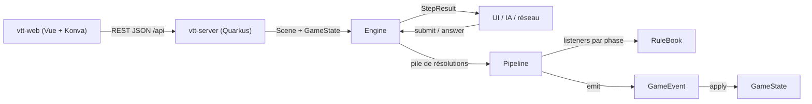

# Architecture

## Stack

- Java avec Maven. Les moteurs n'ont aucune dépendance runtime : ils doivent rester embarquables n'importe où (serveur web, client, outils).
- Modules Maven : `vtt-engine` (moteur générique `solovtt.engine` et scène générique `solovtt.scene`), `dnd-engine` (règles D&D 2024, qui en dépend) et `vtt-server` (Quarkus, REST JSON, qui embarque les moteurs). Un nouveau système de jeu est un module de plus qui dépend de `vtt-engine`.
- Client web `vtt-web` (Vue 3, TypeScript, Vite), hors réacteur Maven. La carte est rendue par Konva dans `src/map/`, sans dépendance à Vue.
- Records, sealed interfaces et pattern matching sur `switch` sont utilisés partout ; ils structurent le moteur.

## Comment ça s'articule

## Décisions clés

- Tout est listener, même les règles de base (`CoreAttackRules`) : ajouter un sort, un don ou une capacité = écrire un listener et l'enregistrer dans `StandardRules`, sans toucher au moteur.
- Une réaction n'est pas un listener mais une `Reaction<T>`, enregistrée auprès de la fenêtre de son déclencheur (`AttackHitReactions` pour une attaque qui touche). La fenêtre empile une `ReactionWindow` qui pose une seule question par créature, avec toutes ses réactions possibles plus « Ne rien faire » : la cible d'abord, puis les autres créatures. Une nouvelle réaction (Contresort) s'ajoute à la fenêtre de son déclencheur, sans nouvelle question.
- Un ordre imposé par les règles devient une phase distincte, jamais une priorité. `Listener.priority()` ne départage qu'une même phase (plus petit = plus tôt, puis ordre d'enregistrement).
- Accumuler puis résoudre : pendant `MODIFY_ROLL`, avantages, désavantages et dés bonus s'empilent dans `AttackContext` ; `ROLL` les résout une seule fois.
- Le moteur est générique sur l'état `S` et l'événement `E extends Event<S>` (`Engine<S, E>`, `Listener<S, E, P, C>`…) ; il ne connaît aucun type de jeu. Côté D&D, `S = GameState` et `E = GameEvent`, et `AttackRule` évite de répéter les quatre paramètres.
- L'état ne change que via `Engine.emit(E)`. Chaque événement sait s'appliquer à l'état ; les jets de dés sont aussi des événements. Rejouer le journal redonne l'état final.
- Le moteur ne bloque jamais de thread : un listener retourne une `Decision`, le pipeline garde son curseur (phase + index) et `Engine` rend `StepResult.AwaitingDecision`.
- Un effet peut empiler sa propre résolution (`Engine.push`) : elle se résout entièrement avant que celle du dessous reprenne.
- Le hasard est injecté (`Dice`) ; le moteur n'appelle jamais `Random` directement.
- L'enchaînement des tours est générique, l'initiative est D&D. `vtt-engine` décrit un tour par `TurnOrder` (round, candidats qui peuvent jouer, créature active) ; la `TurnPolicy<S>` du système rend les candidats au début puis après chaque fin de tour. Un seul candidat devient actif d'office ; plusieurs (ex æquo D&D, « les joueurs » de Daggerheart) font poser « Qui joue ? ».
- Côté D&D (`dnd.engine.combat`), `InitiativePolicy` range les créatures en groupes d'initiative : total décroissant, puis modificateur ; à égalité complète, un groupe dont chaque membre joue une fois par round, dans l'ordre que choisit le joueur. Lancement, fin de tour, arrivée, départ et fin du combat sont des `Resolution` simples (`StartCombat`, `EndTurn`, `JoinCombat`, `LeaveCombat`, `EndCombat`) dont les événements placent l'état : le combat se rejoue. Le joueur termine le combat quand il veut (`CombatEnded`) : plus d'ordre ni de tour, les créatures gardent PV, réaction et effets. Au début de son tour, une créature récupère sa réaction.
- Seule une créature qui peut agir attaque : `AttackAction.refusal` refuse une créature à 0 PV (inconsciente) et, en combat, toute autre que l'active ; `AttackAction.of` lève la raison (400). La feuille porte la même raison (`attackRefusal`) : le client ferme les boutons sans connaître la règle. Le tour d'une créature à terre s'ouvre quand même. Une créature posée tire son initiative et joue ce round-ci si son rang vient après le groupe en cours, sinon au suivant ; une créature retirée quitte l'ordre, et si elle jouait, le tour suivant s'ouvre.
- La carte est générique (`solovtt.scene.Scene`) : elle ne connaît que des positions et des distances réelles, euclidiennes de centre à centre, dans son unité (mètres ou pieds). Chaque système décide de leur usage ; un jeton ne référence son entité que par `entityId`.
- Le serveur tient une seule session en mémoire (`SceneSession`) qui compose la `Scene`, le `GameState` et un `Engine` par carte. La préparation de scène construit l'état initial hors journal ; les actions passent par le moteur, et chaque événement est décrit dans le journal au moment où il est émis. Les dés viennent d'un bean `Dice` (`DiceProducer`, remplaçable en test). Le moteur reçoit `StandardRules.create()` tel quel.
- La partie se garde par ses commandes, derrière le port `GameStore` (`load`, `save`, `setAside`) : chaque appel réussi de `SceneSession` qui la modifie (carte, pose, retrait, déplacement, attaque, combat, réponse) entre dans une `SavedGame` avec les dés tirés pendant l'appel, puis est sauvé ; une commande refusée n'y entre pas, « nouvelle carte » la remet à zéro. Au lancement, la session rejoue ces commandes avec ces dés : scène, état, journal et décision en attente reviennent à l'identique, sans sérialiser l'état ni la lambda de la décision. L'adaptateur `persistence.JsonFileGameStore` porte Jackson et le disque (fichier `solovtt.save.path`, par défaut `~/.solo-vtt/partie.json`, écriture atomique) ; le profil de test n'a pas de fichier.
- Une décision du moteur (réaction Bouclier, « Qui joue ? ») suspend l'action : la session la garde avec la cible de l'action (aucune pour le combat), `/api/decisions` la relit et y répond, et l'action reprend sous le même numéro dans le journal. Tant qu'elle attend, attaque, pose, retrait, lancement du combat, fin de tour et fin du combat sont refusés (`DecisionPendingException`, 409) ; « nouvelle carte » reste permise et jette la décision et le combat. Un refus d'état des règles (combat déjà lancé, aucun combat) devient `ActionRefusedException` (409), jamais une `IllegalStateException` brute (500). Le client la pose dans un `<dialog>` modal (`DecisionDialog`) que seule une option ferme ; le joueur répond pour toute créature.
- Une entrée du journal porte `highlight` (`OUTCOME`, `DAMAGE`, `REACTION`) quand elle dit l'issue d'une attaque, ses dégâts ou une réaction : l'issue porte aussi ses faits (`roll` : touché, raté ou critique, total, CA) et les dégâts les leurs (`damage` : montant, type). Une entrée de dés (`D20Rolled`, `DiceRolled`) porte `dice` : faces, valeurs dans l'ordre du tirage, et pour le d20 la valeur gardée (`kept`, `null` pour les autres dés). Le client range les dés d'avant l'issue en jet d'attaque, ceux d'après en dégâts. La piste à dés se compose de ces entrées, sans lire le texte. Les dés 3D (`vtt-web/src/dice/`, three et cannon-es chargés au premier lancer, sans dépendance à Vue) roulent sur une couche WebGL posée sur la carte : la physique est simulée en entier hors écran, puis la face qui finit en haut échange son numéro avec celle qui porte la valeur du serveur, et les images sont rejouées. La physique ne choisit que le mouvement, jamais la valeur. Deux lancers séparés par l'issue : le jet d'attaque (et une décision éventuelle, ouverte à son arrêt), puis les dégâts. Verdict, PV de la carte et bulle d'issue se posent à l'arrêt ; sous `prefers-reduced-motion`, sans WebGL ou sur erreur, d'emblée.
- En combat, Suppr ne retire que la créature que le joueur a choisie (pas celle que le tour sélectionne) ; Ctrl+Z refuse de reposer une créature retirée, qui tirerait une nouvelle initiative.
- Le client mesure, le serveur tranche : le client calcule les distances d'affichage (mesure, aperçu de glisser) sur les positions qu'il a déjà ; dès qu'une règle dépend d'une distance (portée, déplacement), le serveur la recalcule et fait foi. Le nombre de cases affiché est cette distance euclidienne divisée par la taille d'une case (1,5 m ou 5 ft), pas le décompte de grille de D&D.
- La pose et le déplacement d'un jeton sont hors grille par défaut ; Maj tenue cale sur le centre de la case (`vtt-web/src/map/grid.ts`), le curseur clavier est toujours calé. Seul le client refuse une position où un autre jeton est à moins d'une case de centre à centre : le serveur accepte toute position dans la carte. Une position libre est aimantée au contact (`grid.magnet`) : relâchée à moins d'une case et quart d'une ou plusieurs créatures, elle se colle au point le plus proche qui les touche (une case pile), deux à la fois si elle est dans le creux, sans chevaucher ni dépasser la vitesse restante. Sinon, une créature limitée relâchée à moins d'une demi-case du cercle de sa vitesse restante se colle au bord (`move.snapToLimit`) : elle parcourt pile ce qui lui reste.
- Déplacer : `Scene.move` est générique (bornes de la carte, sans règle). En combat, seule la créature active est limitée, par `dnd.engine.combat.Move` : vitesse restante (fractionnable, SRD p. 14), vitesse 0 à 0 PV ou entravée, refus `IllegalArgumentException` avant toute émission (400) ; son déplacement est l'événement `CreatureMoved`, et `Combat` compte les mètres dépensés, remis à zéro à `TurnStarted`. Toute autre créature, et toute créature hors combat, se repositionne librement, hors journal. La distance est la ligne droite du départ à l'arrivée.
- La vitesse restante arrive au client par `CombatDto.movementLeft`, dans l'unité de la carte ; `null` veut dire illimité (pas de créature active, ou système sans vitesse limitée). Le client n'y ajoute aucune règle : cercle, « reste » et refus de distance n'apparaissent que si une limite existe.
- Les portées sont des règles D&D, dans `dnd-engine` : chaque `Attack` (corps à corps ou distance, lancer compris) porte son allonge ou sa portée en mètres. L'appelant fournit la distance de la carte et son unité à `AttackAction.of`, qui refuse une cible hors d'allonge ou au-delà de la portée longue (`IllegalArgumentException` avec la raison, sans événement) ; `RangeRules` donne le désavantage au-delà de la portée normale. La distance est euclidienne, mais l'allonge accepte une demi-case de plus (`Attack.CONTACT_TOLERANCE`, 0,75 m) : hors grille, une créature n'occupe pas une case exacte. Le contact hors grille et la diagonale (2,12 m) sont à l'allonge d'une arme ordinaire (1,5 m, SRD p. 15 ; la propriété Reach ajoute 1,5 m, p. 90) ; deux cases d'écart (3 m) non. Le client reçoit cette limite (`AttackDto.reachLimit`) pour son cercle de ciblage, et la feuille affiche l'allonge de l'arme.
- Les mètres et les pieds se convertissent à la convention des battlemaps, 1,5 m pour 5 ft (`DistanceUnit.convert`) ; les vitesses sont stockées en mètres dans le moteur.

## Pièges

- `appliesTo` est évalué quand vient le tour du listener, pas au début du pipeline : un effet appliqué plus tôt dans la même action est visible.
- Les listeners d'une phase sont lus à l'entrée de la phase : un listener enregistré pendant l'action ne compte que pour les phases suivantes.
- Le handler d'une `Decision` (`onChoice(option)`) capture le moteur au moment où la décision est créée. C'est une lambda, donc non sérialisable : la sauvegarde rejoue les commandes au lieu de garder la décision.
- Une sauvegarde suppose le code de règles qui l'a écrite : si une règle change le nombre de dés ou une décision, le rejeu échoue, la session démarre sans carte et le fichier est renommé `<nom>.<horodatage>.illisible`. En `quarkus:dev` (8080), un rechargement après une modification de règle peut donc mettre la partie du joueur de côté.
- Une règle qui lève une exception après avoir émis des événements laisse la mémoire modifiée sans commande sauvée : la partie relancée est celle d'avant l'action.
- Une seule décision en attente à la fois : `submit` lève une exception si une décision attend une réponse.
- Pas encore d'effets à durée : le +5 de Bouclier n'est jamais retiré. La réaction revient au début du tour de la créature, donc seulement en combat.
- Les positions vivent dans la `Scene`, hors du journal : rejouer le journal redonne la vitesse dépensée, pas les positions. Un déplacement libre (hors combat, créature non active) n'est pas un événement.
- Une créature posée ou retirée en combat est créée ou supprimée hors journal, comme pendant la préparation : seuls son entrée et son départ de l'ordre de jeu sont des événements. Rejouer le journal suppose donc les mêmes créatures.
- Une entrée du journal porte `round` quand elle ouvre un round : le client en fait un séparateur qui coupe le groupe de l'action.
- Échap est annulé dès `keydown` dans `DecisionDialog` : sans cela, Chromium ferme un dialogue modal au second Échap sans émettre `cancel`.
- Les attaques à distance au contact d'un ennemi (désavantage, SRD p. 15) ne sont pas modélisées : il faudrait savoir qui est hostile.
- `vtt-server` impose JUnit 6 (version du BOM Quarkus) en surchargeant `junit.version` dans son seul `pom.xml` ; les moteurs restent en JUnit 5.
- Sous Windows, arrêter le `mvn quarkus:dev` lancé en arrière-plan ne tue pas le processus Java enfant : le port 8080 reste pris.
