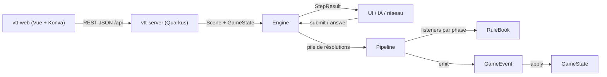

# Architecture

## Stack

- Java avec Maven. Les moteurs n'ont aucune dépendance runtime : ils doivent rester embarquables n'importe où (serveur web, client, outils).
- Modules Maven : `vtt-engine` (moteur générique `solovtt.engine` et scène générique `solovtt.scene`), `dnd-engine` (règles D&D 2024, qui en dépend) et `vtt-server` (Quarkus, REST JSON, qui embarque les moteurs). Un nouveau système de jeu est un module de plus qui dépend de `vtt-engine`.
- Client web `vtt-web` (Vue 3, TypeScript, Vite), hors réacteur Maven. La carte est rendue par Konva dans `src/map/`, sans dépendance à Vue.
- Records, sealed interfaces et pattern matching sur `switch` sont utilisés partout ; ils structurent le moteur.

## Comment ça s'articule

## Décisions clés

- Tout est listener, même les règles de base (`CoreAttackRules`) : ajouter un sort, un don ou une capacité = écrire un listener et l'enregistrer dans `StandardRules`, sans toucher au moteur.
- Une réaction n'est pas un listener mais une `Reaction<T>`, enregistrée auprès de la fenêtre de son déclencheur (`AttackHitReactions` pour une attaque qui touche). La fenêtre empile une `ReactionWindow` qui pose une seule question par créature, avec toutes ses réactions possibles plus « Ne rien faire » : la cible d'abord, puis les autres créatures. Une nouvelle réaction (Contresort) s'ajoute à la fenêtre de son déclencheur, sans nouvelle question.
- Un ordre imposé par les règles devient une phase distincte, jamais une priorité. `Listener.priority()` ne départage qu'une même phase (plus petit = plus tôt, puis ordre d'enregistrement).
- Accumuler puis résoudre : pendant `MODIFY_ROLL`, avantages, désavantages et dés bonus s'empilent dans `AttackContext` ; `ROLL` les résout une seule fois.
- Le moteur est générique sur l'état `S` et l'événement `E extends Event<S>` (`Engine<S, E>`, `Listener<S, E, P, C>`…) ; il ne connaît aucun type de jeu. Côté D&D, `S = GameState` et `E = GameEvent`, et `AttackRule` évite de répéter les quatre paramètres.
- L'état ne change que via `Engine.emit(E)`. Chaque événement sait s'appliquer à l'état ; les jets de dés sont aussi des événements. Rejouer le journal redonne l'état final.
- Le moteur ne bloque jamais de thread : un listener retourne une `Decision`, le pipeline garde son curseur (phase + index) et `Engine` rend `StepResult.AwaitingDecision`.
- Un effet peut empiler sa propre résolution (`Engine.push`) : elle se résout entièrement avant que celle du dessous reprenne.
- Le hasard est injecté (`Dice`) ; le moteur n'appelle jamais `Random` directement.
- L'enchaînement des tours est générique, l'initiative est D&D. `vtt-engine` décrit un tour par `TurnOrder` (round, candidats qui peuvent jouer, créature active) ; la `TurnPolicy<S>` du système rend les candidats au début puis après chaque fin de tour. Un seul candidat devient actif d'office ; plusieurs (ex æquo D&D, « les joueurs » de Daggerheart) font poser « Qui joue ? ».
- Côté D&D (`dnd.engine.combat`), `InitiativePolicy` range les créatures en groupes d'initiative : total décroissant, puis modificateur ; à égalité complète, un groupe dont chaque membre joue une fois par round, dans l'ordre que choisit le joueur. Lancement, fin de tour, arrivée, départ et fin du combat sont des `Resolution` simples (`StartCombat`, `EndTurn`, `JoinCombat`, `LeaveCombat`, `EndCombat`) dont les événements placent l'état : le combat se rejoue. Le joueur termine le combat quand il veut (`CombatEnded`) : plus d'ordre ni de tour, les créatures gardent PV, réaction et effets. Au début de son tour, une créature récupère sa réaction.
- Seule une créature qui peut agir attaque : `AttackAction.refusal` refuse une créature à 0 PV (inconsciente) et, en combat, toute autre que l'active ; `AttackAction.of` lève la raison (400). La feuille porte la même raison (`attackRefusal`) : le client ferme les boutons sans connaître la règle. Le tour d'une créature à terre s'ouvre quand même. Une créature posée tire son initiative et joue ce round-ci si son rang vient après le groupe en cours, sinon au suivant ; une créature retirée quitte l'ordre, et si elle jouait, le tour suivant s'ouvre.
- La carte est générique (`solovtt.scene.Scene`) : elle ne connaît que des positions et des distances réelles, euclidiennes de centre à centre, dans son unité (mètres ou pieds). Chaque système décide de leur usage ; un jeton ne référence son entité que par `entityId`.
- Le serveur tient une `SceneSession` par campagne, en mémoire, qui compose la `Scene`, le `GameState` et un `Engine` par carte. La préparation de scène construit l'état initial hors journal ; les actions passent par le moteur, et chaque événement est décrit dans le journal au moment où il est émis. Les dés viennent d'un bean `Dice` (`DiceProducer`, remplaçable en test). Le moteur reçoit `StandardRules.create()` tel quel.
- La campagne est l'unité de la partie : toute route d'une partie est sous `/api/campaigns/{id}/…` (`scene`, `maps`, `creatures`, `attacks`, `journal`, `decisions`, `combat`, `notebook`) ; seuls `campaigns`, `catalog` et `images` sont communs. `CampaignResource` sert ces routes par des localisateurs de sous-ressources qui construisent `SceneResource`, `MapResource`… sur la session de la campagne. Le registre `CampaignSessions` crée la session d'une campagne à sa première demande, en rejouant sa partie, puis la garde jusqu'à l'arrêt du serveur ; un id inconnu rend 404. Deux campagnes jouent donc côte à côte, et un redémarrage est invisible au client. Le port `CampaignStore` (`list`, `create`, `find`, `games`, `maps`, `notebook`) liste et crée les campagnes (un nom seul, doublons permis) et donne le `GameStore` et le `MapStore` de chacune ; les images restent communes. L'adaptateur `persistence.FileCampaignStore` garde chaque campagne dans `solovtt.campaigns.path/<uuid>/` (par défaut `~/.solo-vtt/campagnes`) : `campagne.json` (id, nom), `partie.json` (`JsonFileGameStore`), `cartes.json` (`JsonFileMapStore`) ; un dossier sans fiche lisible est ignoré, jamais écrasé ; mémoire en test. Les constructeurs de test `SceneSession(Dice)` et `SceneSession(Dice, GameStore)` gardent leurs cartes enregistrées en mémoire.
- La partie se garde par ses commandes, derrière le port `GameStore` (`load`, `save`, `setAside`) : chaque appel réussi de `SceneSession` qui la modifie (carte, pose, retrait, déplacement, attaque, combat, réponse) entre dans une `SavedGame` avec les dés tirés pendant l'appel, puis est sauvé ; une commande refusée n'y entre pas, « nouvelle carte » la remet à zéro. À l'ouverture de la campagne, la session rejoue ces commandes avec ces dés : scène, état, journal et décision en attente reviennent à l'identique, sans sérialiser l'état ni la lambda de la décision. L'adaptateur `persistence.JsonFileGameStore` porte Jackson et le disque (`partie.json` de la campagne, écriture atomique) ; le profil de test n'a pas de fichier.
- Les images de fond des cartes vivent hors de la partie, derrière le port `ImageStore` : chacune est gardée une seule fois sous l'empreinte SHA-256 de ses octets, que la partie référence. `POST /api/images` reçoit les octets bruts (PNG, JPEG ou WebP, signature vérifiée, 415 pour un autre type), `GET /api/images/{id}` les relit, en cache immuable. L'adaptateur `persistence.FileImageStore` écrit `<empreinte>.<ext>` dans `solovtt.images.path` (par défaut `~/.solo-vtt/images`) ; le profil de test les garde en mémoire. Aucune image n'est jamais supprimée. Le corps d'une requête est limité à 50 Mo (`quarkus.http.limits.max-body-size`).
- L'image de fond et l'affichage de la grille appartiennent à la carte de `SceneSession`, pas à `solovtt.scene.Scene` : aucune règle n'en dépend. La commande `Create` garde l'empreinte de l'image (refusée en 400 si inconnue à la création), `ShowGrid` le choix de grille (`PUT /api/scene/grid`), permis en combat et pendant une décision, car c'est de l'affichage. Une nouvelle carte affiche sa grille. Côté client, la carte tire ses dimensions de l'image (`map/backdrop.ts`) : cases = largeur en pixels / taille de case en pixels, chaque case valant 1,5 m ou 5 ft ; l'image est étirée sur toute la carte, dont l'origine est le coin haut gauche de l'image. Le client refuse une image de plus de 50 Mo avant l'envoi : au-delà, le serveur coupe la connexion et le navigateur ne verrait qu'une erreur réseau.
- Caler la grille sur l'image (`PUT /api/scene/alignment`, commande `AlignGrid`) : la grille part d'un décalage gardé par `SceneSession` en fraction de case, dans [0, 1) (`gridOffsetX`, `gridOffsetY`), pour que le serveur ignore la taille d'une case ; il ne sert qu'à l'affichage et au calage côté client. Changer la taille de case change les dimensions de la carte : la `Scene` est remplacée par `Scene.rescaled(nouvelle largeur / ancienne)`, qui multiplie dimensions et positions, donc chaque créature reste au même endroit de l'image. Largeur et hauteur doivent changer d'échelle ensemble (cases carrées, 400 sinon). Refusé (409) en combat, car la vitesse dépensée ne se remet pas à l'échelle, pendant une décision et sur une carte sans image ; permis après « Terminer le combat ».
- Une carte enregistrée (`SavedMap`) est un modèle de départ, pas une partie : dimensions, unité, image, grille, et l'entrée du catalogue et la position de chaque créature, dans l'ordre de pose ; ni PV, ni effets, ni combat, ni journal. Elles vivent derrière le port `MapStore` (adaptateur `persistence.JsonFileMapStore`, toutes dans le `cartes.json` de la campagne, écriture atomique, fichier illisible jamais écrasé ; mémoire en test), une liste par campagne, par nom : enregistrer sous un nom pris remplace la carte. `POST /api/maps` tire la carte en cours (`SceneSession.snapshot`) sans toucher la partie ; `POST /api/maps/load` la recharge (`SceneSession.load`) comme une nouvelle carte, permis en combat et pendant une décision : la partie la copie en commandes ordinaires (`Create`, `ShowGrid`, `Place`), jamais en référence, et n'en garde le nom qu'à titre d'information (`Create.mapName`, `SceneDto.mapName`). Une créature sortie du catalogue refuse le chargement (409) avant tout changement.
- Le Carnet d'une campagne vit hors de la partie, derrière le port `NotebookStore` (`list`, `find`, `create`, `saveContent`, `rename`, `move`, `tabs`, `setTabs`) que donne `CampaignStore.notebook` : des pages (`Page` : id UUID, titre, parent, contenu) et ses onglets (`Tabs` : les pages ouvertes, dans l'ordre, et l'active), gardés par le serveur pour survivre à un redémarrage. `PUT …/notebook/tabs` les remplace en entier : page inconnue 404 ; doublon, ou actif qui n'est pas l'un des onglets (`null` si et seulement si aucun onglet) 400. `GET …/notebook` omet un onglet dont la page n'existe plus, et l'actif avec. Le contenu est le document JSON de l'éditeur (Tiptap), que le serveur garde sans l'interpréter : il vérifie seulement `type: "doc"` (400 sinon). `NotebookResource` (`/api/campaigns/{id}/notebook`) est construit sur le `CampaignStore`, sans `CampaignSessions` : lire le Carnet ne rejoue pas la partie. Page inconnue : `NotFoundException` levée par la ressource (404), car `ErrorMapper` rend 400 pour une `IllegalArgumentException`. L'adaptateur `persistence.JsonFileNotebookStore` écrit dans `<campagne>/carnet/` une fiche par page (`<id>.json`, contenu en JSON imbriqué) et `carnet.json` (`openPageIds` dans l'ordre, `lastPageId` l'onglet actif ; un fichier d'avant les onglets, sans `openPageIds`, se lit en un seul onglet), atomiquement ; une fiche illisible est ignorée, jamais écrasée ; `FileCampaignStore` garde un seul Carnet par campagne. Une base de données remplacera ce port le jour où l'application sera hébergée. L'arbre du Carnet n'est que le `parentId` de chaque page (`null` à la racine), sans ordre stocké : déplacer une page (`PUT …/pages/{id}/parent`) ne réécrit que sa fiche, et ses sous-pages suivent ; renommer passe par `PUT …/pages/{id}/title`, avec le même nettoyage de titre que la création. Le port refuse, sous son verrou, un parent qui serait la page ou l'une de ses sous-pages (`PageTree.isWithin`, 400) ; un parent inconnu rend 404. `GET …/notebook` passe la liste par `PageTree.rooted` : une page dont le parent est illisible, ou qui boucle sur elle-même (fiche éditée à la main), y est rendue à la racine, sans que sa fiche soit réécrite ; une fiche d'avant l'arbre, sans `parentId`, se lit à la racine.
- Ouvrir une campagne mène à son Carnet (`NotebookScreen`), sur ses onglets et l'actif, sinon le premier onglet ; sans onglet, « Aucune page ouverte. », même au retour du combat ; sans page, une invitation à créer la première ; « Combat » ouvre l'écran de jeu (`GameScreen`), dont le bouton Carnet ramène. `App.vue` monte l'un ou l'autre (`v-if`) : chacun relit la campagne au serveur en se montant, rien n'est gardé côté client entre deux écrans. Toute ouverture d'une page (arbre, lien, résultat de recherche, page citante, création) l'ajoute en onglet, en fin de barre (`PageTabs`), ou active le sien, puis envoie tous les onglets (`PUT …/notebook/tabs`) ; un échec de cet envoi va au bandeau sans fermer la page. Un seul éditeur est monté, celui de l'onglet actif : activer un onglet relit sa page au serveur et la rouvre verrouillée, sans l'annulation ni le défilement d'avant. Fermer l'onglet actif attend l'envoi de la frappe (refus : rien ne ferme), puis active le voisin de droite, sinon de gauche ; sans onglet, « Aucune page ouverte. ». Fermé au clavier, le focus passe à l'onglet actif. Les titres des onglets viennent de la liste des pages : un renommage s'y voit aussitôt. Les pages s'affichent en arbre (`PageTree`, rendu récursif par `PageBranch`), que le client tire de la liste plate (`notebook/tree.ts`) : sœurs triées par titre en ordre numérique (`Intl.Collator`, `numeric`), « Session 2 » avant « Session 10 », sans ordre manuel. Les branches dépliées vivent dans `NotebookScreen` seulement : à l'ouverture, à la création et au déplacement d'une page, ses ancêtres se déplient ; au retour du combat, seul ce chemin l'est. Chaque ligne a un menu (Nouvelle sous-page, Renommer, Déplacer sous…) ; renommer et créer ouvrent un champ dans l'arbre, Déplacer ouvre `MovePageDialog`, qui montre toutes les pages et éteint la page, ses sous-pages et sa place actuelle (`canMove`). À la souris et au stylet, `PageTree` déplace aussi par glisser-déposer, en événements pointeur (au-delà de 6 px, cible par `document.elementFromPoint`, mêmes refus par `canMove`, sans requête), vers une ligne ou la zone « Racine du Carnet » ; le toucher ne glisse pas et garde le menu, comme le clavier. Une page déverrouillée se renomme aussi par son titre, qui devient un champ de même allure. Après chaque geste, le Carnet relit l'arbre au serveur, refus compris. Le corps d'une page est un éditeur Tiptap 3 (`PageEditor`, StarterKit sans `link`), un par page (`:key`) pour que l'annulation ne passe pas d'une page à l'autre. Le verrou est purement client : une page s'ouvre verrouillée, sauf celle qu'on vient de créer ; verrouillée, l'éditeur n'est pas éditable : ProseMirror n'exécute alors ni touches, ni collage, ni dépôt (ses `editorProps` ne sont qu'une garde). L'enregistrement est automatique : envoi du document entier une seconde après la dernière frappe, un envoi à la fois ; avant d'ouvrir une autre page, de créer ou de quitter l'écran, le Carnet attend l'envoi et reste sur place s'il échoue (erreur affichée, contenu gardé et renvoyé au changement suivant) ; `visibilitychange` vers `hidden` envoie aussi, et `pagehide` renvoie en `keepalive` sous 60 Ko.
- Une image dans une page du Carnet est un nœud Tiptap bloc, atomique, `pageImage { imageId, alt }` (`notebook/pageImage.ts`) : le document garde l'empreinte de l'image, jamais son adresse, et `alt` le nom du fichier, affiché si l'image ne se lit plus. Les images des pages vivent dans le même `ImageStore` que les fonds de carte (`POST /api/images`), communes à toutes les campagnes ; ni les liens entrants ni la recherche ne lisent ce nœud. Page déverrouillée, le bouton Image de la tête de page choisit un fichier ; `PageEditor.insertImage` le refuse avant l'envoi (`src/images.ts`, `imageRefusal` : PNG, JPEG ou WebP, 50 Mo au plus, mêmes règles que la carte), sinon l'envoie puis l'insère au curseur en une seule commande, que Ctrl+Z défait ; la raison d'un refus va au bandeau d'erreur. En écriture, des fichiers déposés ou collés sur le texte (`handleDrop`, `handlePaste`) entrent de même, dans l'ordre, le premier au point de dépôt ; un collage sans fichier ne change pas. Verrouillée, ProseMirror n'appelle pas ces gestionnaires : `NotebookScreen` empêche alors, comme partout hors du texte éditable, qu'un fichier lâché soit ouvert par le navigateur à la place de l'application (`dropEffect` `none`). Le curseur passe ensuite dans le texte voisin, sinon l'image suivante remplacerait celle qu'on vient de poser. Retirer une image de la page (sélection puis Retour arrière) ne supprime rien sur le serveur : Ctrl+Z la remet sans nouvel envoi.
- Un lien entre pages du Carnet est un nœud Tiptap en ligne, atomique, `pageLink { pageId, label }` (`notebook/pageLink.ts`) : le titre de la cible n'est jamais stocké, `label` est le texte choisi (`null` : le titre). Le lien lit à l'affichage la liste des pages que `NotebookScreen` relit à chaque geste ; renommer ou déplacer la cible ne réécrit donc aucune page, et une cible absente de la liste donne un lien mort (« page introuvable » sans `label`), qui n'ouvre rien. Ce format est le contrat que liront les liens entrants et la corbeille ; le serveur ne le valide jamais à l'enregistrement, mais le lit pour les liens entrants : `GET …/notebook/pages/{id}/citing` (`PageLinks.citing`) parcourt à chaque appel le contenu de toutes les pages, sans index, et rend celles qui ont un nœud `pageLink` vers la page, triées par titre, sans la page elle-même ; un contenu illisible est sauté. Le client (`CitingPages`, sous le texte) la relit à l'ouverture de la page seulement : un lien s'ajoute ou se retire dans une autre page, donc avant de rouvrir celle-ci (`open` attend l'enregistrement) ; il ne garde que les ids et tire les titres de la liste des pages, si bien qu'un renommage s'y voit aussitôt. Un échec de lecture laisse la page ouverte, sans liste, l'erreur dans le bandeau. Taper `[[` ouvre la liste des pages (`@tiptap/suggestion`, `PageLinkList`), filtrée sur le titre sans casse ni accents ; insérer est une seule commande, que Ctrl+Z défait. Page verrouillée, un clic ou Entrée sur le lien (`<a href>`, atteignable au Tab) ouvre la cible par `NotebookScreen.open`, qui attend l'enregistrement ; en écriture, un clic ou les flèches le sélectionnent (`NodeSelection`) et montrent sa bulle (`PageLinkBubble`, `BubbleMenu` de Tiptap) : « Ouvrir » et « Texte affiché », posé en un seul pas d'annulation ; Ctrl+clic l'ouvre. En écriture, le lien sort de l'ordre du Tab (`tabindex=-1`), et le cadre de la bulle aussi, que Tiptap rend focusable. La liste des pages et l'état du verrou passent à l'extension par des fonctions (`pages`, `locked`), jamais une `Ref` : Tiptap copie les options en profondeur et perdrait sa valeur.
- La recherche du Carnet est une boîte noire du port `NotebookStore`, comme sa persistance : `search(query)` rend les pages dont le titre ou le texte contient chaque mot, sans casse ni accents, celles au titre trouvé d'abord, chacune avec un extrait déjà découpé en morceaux (`Fragment { text, match }`) ; `GET …/notebook/search?q=` (400 sans mot) ne connaît que ce contrat, et le client affiche les morceaux sans rien replier. L'implémentation par défaut (`PageSearch`, méthode `default` héritée par `inMemory` et `JsonFileNotebookStore`) relit `list()` à chaque appel, sans index : le texte d'une page est la suite de ses nœuds `text` et du texte affiché de ses liens (`label`, sinon le titre de la cible), un espace entre deux blocs ; titre et texte sont pliés caractère par caractère (NFD sans `\p{M}`, minuscule), ce qui garde les positions ; l'extrait part du premier mot trouvé dans le texte (40 caractères avant, 80 après, coupé aux espaces, « … » aux bords), sinon du début du texte (120 caractères) ; un contenu illisible est cherché sur son titre seul. Un adaptateur à index ou une base la remplace sans toucher la ressource ni le client. Côté client, le champ « Chercher » du panneau Pages lance la recherche 250 ms après la dernière frappe, après avoir envoyé la frappe en attente de la page ouverte (`saved`, sinon rien ne part) ; un numéro de recherche ignore une réponse périmée ; tant que le champ n'est pas vide, `SearchResults` remplace l'arbre, qui revient tel qu'il était déplié quand on le vide (Échap, « Effacer ») ; ouvrir un résultat passe par `open` et garde la liste.
- Une décision du moteur (réaction Bouclier, « Qui joue ? ») suspend l'action : la session la garde avec la cible de l'action (aucune pour le combat), `/api/decisions` la relit et y répond, et l'action reprend sous le même numéro dans le journal. Tant qu'elle attend, attaque, pose, retrait, lancement du combat, fin de tour et fin du combat sont refusés (`DecisionPendingException`, 409) ; « nouvelle carte » reste permise et jette la décision et le combat. Un refus d'état des règles (combat déjà lancé, aucun combat) devient `ActionRefusedException` (409), jamais une `IllegalStateException` brute (500). Le client la pose dans un `<dialog>` modal (`DecisionDialog`) que seule une option ferme ; le joueur répond pour toute créature.
- Une entrée du journal porte `highlight` (`OUTCOME`, `DAMAGE`, `REACTION`) quand elle dit l'issue d'une attaque, ses dégâts ou une réaction : l'issue porte aussi ses faits (`roll` : touché, raté ou critique, total, CA) et les dégâts les leurs (`damage` : montant, type). Une entrée de dés (`D20Rolled`, `DiceRolled`) porte `dice` : faces, valeurs dans l'ordre du tirage, et pour le d20 la valeur gardée (`kept`, `null` pour les autres dés). Le client range les dés d'avant l'issue en jet d'attaque, ceux d'après en dégâts. La piste à dés se compose de ces entrées, sans lire le texte. Les dés 3D (`vtt-web/src/dice/`, three et cannon-es chargés au premier lancer, sans dépendance à Vue) roulent sur une couche WebGL posée sur la carte : la physique est simulée en entier hors écran, puis la face qui finit en haut échange son numéro avec celle qui porte la valeur du serveur, et les images sont rejouées. La physique ne choisit que le mouvement, jamais la valeur. Deux lancers séparés par l'issue : le jet d'attaque (et une décision éventuelle, ouverte à son arrêt), puis les dégâts. Verdict, PV de la carte et bulle d'issue se posent à l'arrêt ; sous `prefers-reduced-motion`, sans WebGL ou sur erreur, d'emblée.
- En combat, Suppr ne retire que la créature que le joueur a choisie (pas celle que le tour sélectionne) ; Ctrl+Z refuse de reposer une créature retirée, qui tirerait une nouvelle initiative.
- La vue de la carte (zoom de ×1, carte entière, à ×8, et centre en fraction de carte, `vtt-web/src/map/view.ts`) n'est qu'affichage : ni le serveur ni la partie ne la connaissent. `SceneCanvas` en tire `pixelsPerUnit` et `origin` et redessine (pas d'échelle Konva), si bien que toute conversion pixels ↔ unité de carte la suit et que les étiquettes gardent leur taille. Elle survit au calage et au redimensionnement ; l'application la remet à la carte entière à la création et au chargement d'une carte, car `MapView` n'est pas remonté entre deux cartes. Glisser le fond à la souris (bouton gauche, hors jeton qui écoute, au-delà de 4 px) déplace la vue, calage compris, et le clic qui suit est ignoré ; au toucher, un doigt laisse défiler la page (`touch-action: pan-x pan-y`), deux doigts déplacent et zooment. Pendant le calage, le bouton du milieu décale la grille.
- Le client mesure, le serveur tranche : le client calcule les distances d'affichage (mesure, aperçu de glisser) sur les positions qu'il a déjà ; dès qu'une règle dépend d'une distance (portée, déplacement), le serveur la recalcule et fait foi. Le nombre de cases affiché est cette distance euclidienne divisée par la taille d'une case (1,5 m ou 5 ft), pas le décompte de grille de D&D.
- Une créature se pose en la glissant du catalogue sur la carte, en événements pointeur (souris et doigt, `CatalogPanel`) : l'entrée capture le pointeur, la carte vise depuis les coordonnées de la fenêtre (`SceneCanvas.dragOver`, `dropTarget`) et dessine le fantôme ; près du bord de la fenêtre, la page défile. Le clic de souris ou le toucher sur une entrée ne fait rien : seule une activation clavier ou lecteur d'écran (`click` à `detail` 0) arme la pose et donne le focus à la carte, où elle se fait au curseur de case (ou au clic) ; Échap rend le focus à l'entrée. Les deux chemins posent par `placeEntry`.
- La pose et le déplacement d'un jeton sont hors grille par défaut ; Maj tenue cale sur le centre de la case (`vtt-web/src/map/grid.ts`), le curseur clavier est toujours calé. Seul le client refuse une position où un autre jeton est à moins d'une case de centre à centre : le serveur accepte toute position dans la carte. Une position libre est aimantée au contact (`grid.magnet`) : relâchée à moins d'une case et quart d'une ou plusieurs créatures, elle se colle au point le plus proche qui les touche (une case pile), deux à la fois si elle est dans le creux, sans chevaucher ni dépasser la vitesse restante. Sinon, une créature limitée relâchée à moins d'une demi-case du cercle de sa vitesse restante se colle au bord (`move.snapToLimit`) : elle parcourt pile ce qui lui reste.
- Déplacer : `Scene.move` est générique (bornes de la carte, sans règle). En combat, seule la créature active est limitée, par `dnd.engine.combat.Move` : vitesse restante (fractionnable, SRD p. 14), vitesse 0 à 0 PV ou entravée, refus `IllegalArgumentException` avant toute émission (400) ; son déplacement est l'événement `CreatureMoved`, et `Combat` compte les mètres dépensés, remis à zéro à `TurnStarted`. Toute autre créature, et toute créature hors combat, se repositionne librement, hors journal. La distance est la ligne droite du départ à l'arrivée.
- La vitesse restante arrive au client par `CombatDto.movementLeft`, dans l'unité de la carte ; `null` veut dire illimité (pas de créature active, ou système sans vitesse limitée). Le client n'y ajoute aucune règle : cercle, « reste » et refus de distance n'apparaissent que si une limite existe.
- Les portées sont des règles D&D, dans `dnd-engine` : chaque `Attack` (corps à corps ou distance, lancer compris) porte son allonge ou sa portée en mètres. L'appelant fournit la distance de la carte et son unité à `AttackAction.of`, qui refuse une cible hors d'allonge ou au-delà de la portée longue (`IllegalArgumentException` avec la raison, sans événement) ; `RangeRules` donne le désavantage au-delà de la portée normale. La distance est euclidienne, mais l'allonge accepte une demi-case de plus (`Attack.CONTACT_TOLERANCE`, 0,75 m) : hors grille, une créature n'occupe pas une case exacte. Le contact hors grille et la diagonale (2,12 m) sont à l'allonge d'une arme ordinaire (1,5 m, SRD p. 15 ; la propriété Reach ajoute 1,5 m, p. 90) ; deux cases d'écart (3 m) non. Le client reçoit cette limite (`AttackDto.reachLimit`) pour son cercle de ciblage, et la feuille affiche l'allonge de l'arme.
- Les mètres et les pieds se convertissent à la convention des battlemaps, 1,5 m pour 5 ft (`DistanceUnit.convert`) ; les vitesses sont stockées en mètres dans le moteur.

## Pièges

- `appliesTo` est évalué quand vient le tour du listener, pas au début du pipeline : un effet appliqué plus tôt dans la même action est visible.
- Les listeners d'une phase sont lus à l'entrée de la phase : un listener enregistré pendant l'action ne compte que pour les phases suivantes.
- Le handler d'une `Decision` (`onChoice(option)`) capture le moteur au moment où la décision est créée. C'est une lambda, donc non sérialisable : la sauvegarde rejoue les commandes au lieu de garder la décision.
- Une sauvegarde suppose le code de règles qui l'a écrite : si une règle change le nombre de dés ou une décision, le rejeu échoue, la session démarre sans carte et le fichier est renommé `<nom>.<horodatage>.illisible`. En `quarkus:dev` (8080), un rechargement après une modification de règle peut donc mettre la partie du joueur de côté.
- Une règle qui lève une exception après avoir émis des événements laisse la mémoire modifiée sans commande sauvée : la partie relancée est celle d'avant l'action.
- Une image effacée du dossier d'images ne casse pas la reprise : la partie se rejoue et la carte revient sans fond (`/api/images/{id}` rend 404).
- Une carte enregistrée dont l'image a été effacée se charge quand même, sans fond.
- Une campagne demandée reste en mémoire jusqu'à l'arrêt du serveur : aucune éviction. Deux onglets sur la même campagne partagent sa session.
- Le Carnet n'a pas de verrou entre deux onglets : chacun enregistre la page entière, et le dernier enregistrement l'emporte.
- Une page de plus de 60 Ko fermée moins d'une seconde après la dernière frappe ne compte que sur l'envoi de `visibilitychange` : le plafond `keepalive` (64 Kio) n'est pas vérifié au-delà.
- Les anciens `~/.solo-vtt/partie.json` et `cartes.json` (avant les campagnes) ne sont plus lus.
- Une seule décision en attente à la fois : `submit` lève une exception si une décision attend une réponse.
- Agrandir la case au calage rapproche les créatures en unités de carte : deux créatures au contact peuvent ensuite se chevaucher, ce que le client refuse seulement pour une nouvelle position.
- Pas encore d'effets à durée : le +5 de Bouclier n'est jamais retiré. La réaction revient au début du tour de la créature, donc seulement en combat.
- Les positions vivent dans la `Scene`, hors du journal : rejouer le journal redonne la vitesse dépensée, pas les positions. Un déplacement libre (hors combat, créature non active) n'est pas un événement.
- Une créature posée ou retirée en combat est créée ou supprimée hors journal, comme pendant la préparation : seuls son entrée et son départ de l'ordre de jeu sont des événements. Rejouer le journal suppose donc les mêmes créatures.
- Une entrée du journal porte `round` quand elle ouvre un round : le client en fait un séparateur qui coupe le groupe de l'action.
- Échap est annulé dès `keydown` dans `DecisionDialog` : sans cela, Chromium ferme un dialogue modal au second Échap sans émettre `cancel`.
- Les attaques à distance au contact d'un ennemi (désavantage, SRD p. 15) ne sont pas modélisées : il faudrait savoir qui est hostile.
- `vtt-server` impose JUnit 6 (version du BOM Quarkus) en surchargeant `junit.version` dans son seul `pom.xml` ; les moteurs restent en JUnit 5.
- Sous Windows, arrêter le `mvn quarkus:dev` lancé en arrière-plan ne tue pas le processus Java enfant : le port 8080 reste pris.
