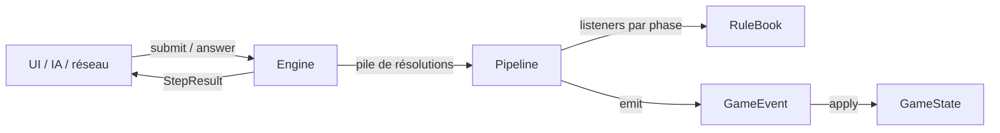

# Architecture

## Stack

- Java avec Maven, sans aucune dépendance runtime : le moteur doit rester embarquable n'importe où (serveur web, client, outils).
- Deux modules : `vtt-engine` (moteur générique, package `solovtt.engine`) et `dnd-engine` (règles D&D 2024), qui en dépend. Un nouveau système de jeu est un module de plus qui dépend de `vtt-engine`.
- Records, sealed interfaces et pattern matching sur `switch` sont utilisés partout ; ils structurent le moteur.

## Comment ça s'articule

## Décisions clés

- Tout est listener, même les règles de base (`CoreAttackRules`) : ajouter un sort, un don ou une capacité = écrire un listener et l'enregistrer dans `StandardRules`, sans toucher au moteur.
- Un ordre imposé par les règles devient une phase distincte, jamais une priorité. `Listener.priority()` ne départage qu'une même phase (plus petit = plus tôt, puis ordre d'enregistrement).
- Accumuler puis résoudre : pendant `MODIFY_ROLL`, avantages, désavantages et dés bonus s'empilent dans `AttackContext` ; `ROLL` les résout une seule fois.
- Le moteur est générique sur l'état `S` et l'événement `E extends Event<S>` (`Engine<S, E>`, `Listener<S, E, P, C>`…) ; il ne connaît aucun type de jeu. Côté D&D, `S = GameState` et `E = GameEvent`, et `AttackRule` évite de répéter les quatre paramètres.
- L'état ne change que via `Engine.emit(E)`. Chaque événement sait s'appliquer à l'état ; les jets de dés sont aussi des événements. Rejouer le journal redonne l'état final.
- Le moteur ne bloque jamais de thread : un listener retourne une `Decision`, le pipeline garde son curseur (phase + index) et `Engine` rend `StepResult.AwaitingDecision`.
- Un effet peut empiler sa propre résolution (`Engine.push`) : elle se résout entièrement avant que celle du dessous reprenne.
- Le hasard est injecté (`Dice`) ; le moteur n'appelle jamais `Random` directement.

## Pièges

- `appliesTo` est évalué quand vient le tour du listener, pas au début du pipeline : un effet appliqué plus tôt dans la même action est visible.
- Les listeners d'une phase sont lus à l'entrée de la phase : un listener enregistré pendant l'action ne compte que pour les phases suivantes.
- Le handler d'une `Decision` (`onChoice(option)`) capture le moteur au moment où la décision est créée. C'est une lambda, donc non sérialisable : une partie en attente de décision ne peut pas encore être sauvegardée.
- Une seule décision en attente à la fois : `submit` lève une exception si une décision attend une réponse.
- Pas encore de structure de tour ni d'effets à durée : le +5 de Bouclier n'est jamais retiré.
