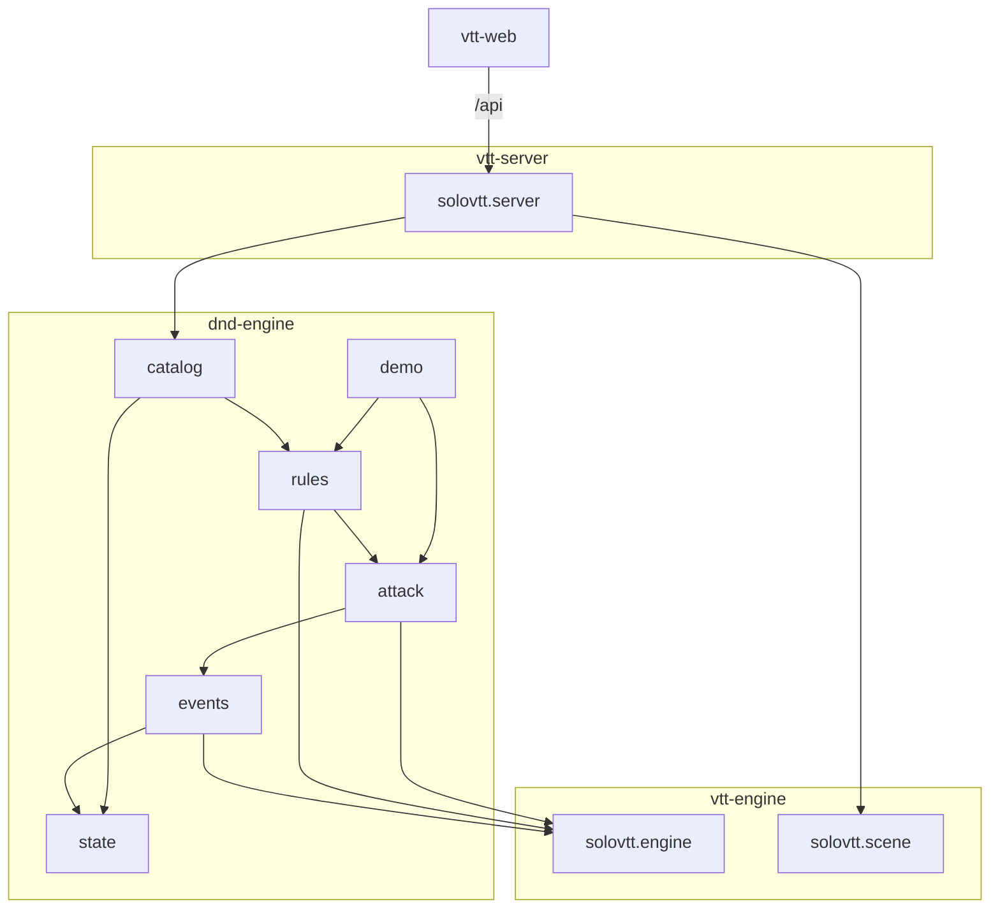

# Carte du code

## Zones

- `pom.xml` (racine) : agrégateur Maven `solovtt:solo-vtt`, qui porte les versions communes.
- `vtt-engine/` : le moteur générique (`solovtt.engine` : `Engine`, `Pipeline`, `Listener`, `RuleBook`, `Event`, `Decision`, `Dice`, `TurnOrder`, `TurnPolicy`) et la scène (`solovtt.scene` : `Scene` qui pose, déplace et retire les jetons, `Token`, `Position`, `DistanceUnit`). Il ne contient aucune règle ni aucun type de jeu.
- `dnd-engine/` : les règles D&D 2024, qui dépendent de `vtt-engine`.
  - `state/` : l'état du jeu (`GameState`, `Creature` avec son modificateur d'initiative, `Combat` et ses `InitiativeGroup`, `Weapon`, `Attack` avec allonge et portée, conditions, types de dégâts).
  - `combat/` : l'enchaînement des tours D&D (`InitiativePolicy`), ses résolutions `StartCombat`, `EndTurn`, `JoinCombat`, `LeaveCombat`, `EndCombat`, et `Move`, le déplacement de la créature active dans sa vitesse restante.
  - `events/` : `GameEvent` (sealed, `extends Event<GameState>`), tout ce qui arrive et comment ça modifie l'état.
  - `attack/` : l'action « attaque », c'est-à-dire ses phases, son contexte, `AttackRule` et les règles de base 2024.
  - `rules/` : les règles optionnelles (`RangeRules` pour la portée longue…), les réactions (`Reaction`, `ReactionWindow`, `AttackHitReactions`, `ShieldReaction`) et `StandardRules`, qui assemble le `RuleBook`.
  - `catalog/` : `SrdCatalog`, les créatures prêtes à l'emploi du SRD 5.2.1.
  - `demo/` : démonstration console.
- `vtt-server/` : serveur Quarkus (`solovtt.server`). `SceneSession` tient la scène et l'état, et garde la partie (`SavedGame`) par le port `GameStore` ; `persistence/` porte l'adaptateur fichier JSON (`JsonFileGameStore`) et son producteur (`GameStoreProducer`, propriété `solovtt.save.path`) ; les images de carte passent par le port `ImageStore`, gardées par `persistence/FileImageStore` (`ImageStoreProducer`, propriété `solovtt.images.path`) ; les cartes enregistrées (`SavedMap`) passent par le port `MapStore`, gardées par `persistence/JsonFileMapStore` (`MapStoreProducer`, propriété `solovtt.maps.path`) et servies par `MapResource` ; les ressources REST sont sous `/api` (`catalog`, `images`, `images/{id}`, `maps`, `maps/load`, `scene`, `scene/grid`, `scene/tokens`, `scene/tokens/{id}/move`, `creatures/{id}`, `attacks`, `journal`, `decisions`, `combat`, `combat/end-turn`, `combat/end`). Attaque, combat et réponse à une décision rendent un `ActionResultDto`, dont la cible est facultative.
- `vtt-web/` : client Vue 3 + TypeScript. `src/api.ts` appelle le serveur, `src/map/SceneCanvas.ts` dessine la carte avec Konva (jetons glissables), `src/map/move.ts` vérifie un déplacement envisagé, `src/map/backdrop.ts` tire les dimensions d'une carte de son image, `src/dice/` lance les dés 3D sur la carte (formes des dés dans `shapes.ts`, simulation et rendu dans `DiceRoller.ts`), `src/components/` porte les panneaux (rail et tiroirs catalogue / nouvelle carte / cartes enregistrées `SavedMapsPanel`, contrôle de combat `CombatControl` dans la barre, tableau « Sur la carte » trié par initiative en combat, piste à dés, onglets Feuille / Cible / Journal, dialogue de décision `DecisionDialog`). L'univers visuel et ses jetons (thèmes sombre et clair, `src/style.css`) sont décrits dans `DESIGN.md`.

## Points d'entrée

- `dnd.engine.demo.Main` : la démo console (`--interactif`, `--seed=N`). Après un `mvn compile` à la racine, elle se lance depuis `dnd-engine/` avec `java -cp "target/classes;../vtt-engine/target/classes" dnd.engine.demo.Main` (le séparateur est `:` hors Windows).
- Pour un appelant : `new Engine<>(state, StandardRules.create(), dice)`, puis `submit` et `answer`.
- L'application : `mvn install -DskipTests` à la racine, puis `mvn quarkus:dev -pl vtt-server` (port 8080) et, dans `vtt-web/`, `npm install` puis `npm run dev` (port 5173, proxy `/api` vers 8080).
- L'API : en mode dev, Swagger UI sur `/q/swagger-ui` et la spécification sur `/q/openapi` (`quarkus-smallrye-openapi`). Codes d'erreur décrits par `@APIResponse` sur chaque ressource. Une requête lancée depuis Swagger modifie la session du serveur visé.
