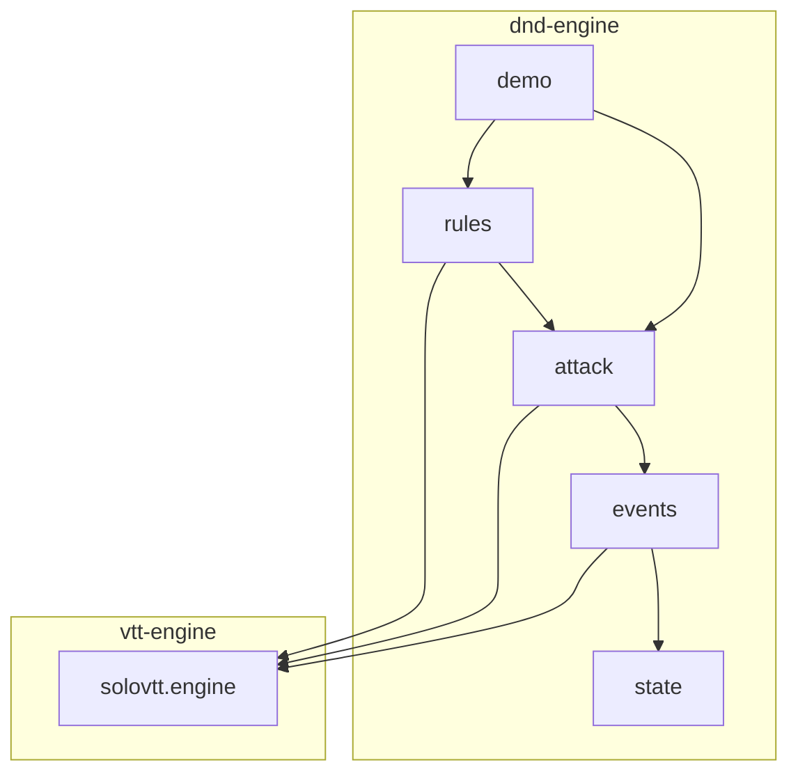

# Carte du code

## Zones

- `pom.xml` (racine) : agrégateur Maven `solovtt:solo-vtt`, qui porte les versions communes.
- `vtt-engine/` : le moteur générique (`solovtt.engine` : `Engine`, `Pipeline`, `Listener`, `RuleBook`, `Event`, `Decision`, `Dice`). Il ne contient aucune règle ni aucun type de jeu.
- `dnd-engine/` : les règles D&D 2024, qui dépendent de `vtt-engine`.
  - `state/` : l'état du jeu (`GameState`, `Creature`, armes, conditions, types de dégâts).
  - `events/` : `GameEvent` (sealed, `extends Event<GameState>`), tout ce qui arrive et comment ça modifie l'état.
  - `attack/` : l'action « attaque », c'est-à-dire ses phases, son contexte, `AttackRule` et les règles de base 2024.
  - `rules/` : les règles optionnelles et `StandardRules`, qui assemble le `RuleBook`.
  - `demo/` : démonstration console.

## Points d'entrée

- `dnd.engine.demo.Main` : la démo console (`--interactif`, `--seed=N`). Après un `mvn compile` à la racine, elle se lance depuis `dnd-engine/` avec `java -cp "target/classes;../vtt-engine/target/classes" dnd.engine.demo.Main` (le séparateur est `:` hors Windows).
- Pour un appelant : `new Engine<>(state, StandardRules.create(), dice)`, puis `submit` et `answer`.
