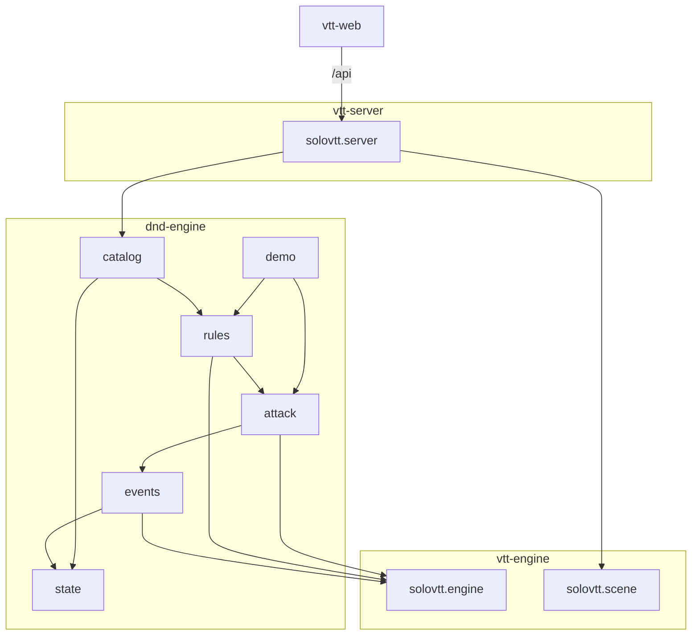

# Carte du code

## Zones

- `pom.xml` (racine) : agrégateur Maven `solovtt:solo-vtt`, qui porte les versions communes.
- `vtt-engine/` : le moteur générique (`solovtt.engine` : `Engine`, `Pipeline`, `Listener`, `RuleBook`, `Event`, `Decision`, `Dice`, `TurnOrder`, `TurnPolicy`) et la scène (`solovtt.scene` : `Scene` qui pose, déplace et retire les jetons, `Token`, `Position`, `DistanceUnit`). Il ne contient aucune règle ni aucun type de jeu.
- `dnd-engine/` : les règles D&D 2024, qui dépendent de `vtt-engine`.
  - `state/` : l'état du jeu (`GameState`, `Creature` avec son modificateur d'initiative, `Combat` et ses `InitiativeGroup`, `Weapon`, `Attack` avec allonge et portée, conditions, types de dégâts).
  - `combat/` : l'enchaînement des tours D&D (`InitiativePolicy`), ses résolutions `StartCombat`, `EndTurn`, `JoinCombat`, `LeaveCombat`, `EndCombat`, et `Move`, le déplacement de la créature active dans sa vitesse restante.
  - `events/` : `GameEvent` (sealed, `extends Event<GameState>`), tout ce qui arrive et comment ça modifie l'état.
  - `attack/` : l'action « attaque », c'est-à-dire ses phases, son contexte, `AttackRule` et les règles de base 2024.
  - `rules/` : les règles optionnelles (`RangeRules` pour la portée longue…), les réactions (`Reaction`, `ReactionWindow`, `AttackHitReactions`, `ShieldReaction`) et `StandardRules`, qui assemble le `RuleBook`.
  - `catalog/` : `SrdCatalog`, les créatures prêtes à l'emploi du SRD 5.2.1.
  - `demo/` : démonstration console.
- `vtt-server/` : serveur Quarkus (`solovtt.server`). `SceneSession` tient la partie d'une campagne (`Campaign`), sa scène et son état, et la garde (`SavedGame`) par le port `GameStore` ; `CampaignSessions` tient une session par campagne ; les campagnes passent par le port `CampaignStore`, gardées par `persistence/FileCampaignStore` (`CampaignStoreProducer`, propriété `solovtt.campaigns.path`) et servies par `CampaignResource`, chacune avec sa partie (`persistence/JsonFileGameStore`) et ses cartes enregistrées (`persistence/JsonFileMapStore`) ; les images de carte passent par le port `ImageStore`, gardées par `persistence/FileImageStore` (`ImageStoreProducer`, propriété `solovtt.images.path`) ; les cartes enregistrées (`SavedMap`) passent par le port `MapStore` de la campagne (`SceneSession.maps`) et sont servies par `MapResource` ; le Carnet (`Page`, rangées en arbre par leur parent, `PageTree` ; liens entrants lus par `PageLinks` ; recherche `NotebookStore.search`, par défaut `PageSearch`) passe par le port `NotebookStore` de la campagne (`CampaignStore.notebook`, adaptateur `persistence/JsonFileNotebookStore`) et est servi par `NotebookResource` ; les ressources REST communes sont sous `/api` (`campaigns`, `catalog`, `images`, `images/{id}`), celles d'une partie sous `/api/campaigns/{id}` (`maps`, `maps/load`, `scene`, `scene/grid`, `scene/alignment`, `scene/tokens`, `scene/tokens/{id}/move`, `creatures/{id}`, `attacks`, `journal`, `decisions`, `combat`, `combat/end-turn`, `combat/end`, `notebook`, `notebook/pages`, `notebook/pages/{id}`, `notebook/pages/{id}/content`, `notebook/pages/{id}/title`, `notebook/pages/{id}/parent`, `notebook/pages/{id}/citing`, `notebook/search`, `notebook/last-page`). Attaque, combat et réponse à une décision rendent un `ActionResultDto`, dont la cible est facultative.
- `vtt-web/` : client Vue 3 + TypeScript. `src/api.ts` appelle le serveur, `src/map/SceneCanvas.ts` dessine la carte avec Konva (jetons glissables), `src/map/move.ts` vérifie un déplacement envisagé, `src/map/backdrop.ts` tire les dimensions d'une carte de son image, `src/map/alignment.ts` passe du calage en pixels d'image aux dimensions et au décalage de grille de la carte, `src/map/grid.ts` cale sur la grille décalée, `src/map/view.ts` tient la vue (zoom, centre) et la place dans le cadre, `src/dice/` lance les dés 3D sur la carte (formes des dés dans `shapes.ts`, simulation et rendu dans `DiceRoller.ts`), `src/App.vue` montre l'accueil (`components/HomeScreen.vue` : liste et création des campagnes), le Carnet de la campagne (`components/NotebookScreen.vue` : arbre, création, page ouverte, titre éditable, verrou, enregistrement automatique ; `components/PageTree.vue` et `PageBranch.vue` : l'arbre des pages et le menu de chaque ligne ; `components/MovePageDialog.vue` : choisir où ranger une page ; `src/notebook/tree.ts` : l'arbre tiré de la liste plate, sans Vue ; `components/PageEditor.vue` : l'éditeur Tiptap d'une page ; `src/notebook/pageLink.ts` : le nœud lien de page et sa suggestion `[[`, `src/notebook/pageImage.ts` : le nœud image d'une page, `src/images.ts` : les images acceptées par le serveur, pour la carte et la page, `src/notebook/links.ts` : texte d'un lien et pages proposées, `components/PageLinkView.vue` : un lien dans le texte, `components/PageLinkList.vue` : la liste des pages à lier, `components/PageLinkBubble.vue` : la bulle d'un lien sélectionné ; `components/CitingPages.vue` : les pages qui citent la page ouverte ; `components/SearchResults.vue` : les résultats de la recherche, à la place de l'arbre) ou l'écran de jeu (`components/GameScreen.vue`), chacun remonté à chaque campagne par sa `key`, `src/components/` porte aussi les panneaux (rail et tiroirs catalogue / nouvelle carte, avec le calage de la grille `GridAlignPanel` sous le formulaire / cartes enregistrées `SavedMapsPanel`, contrôle de combat `CombatControl` dans la barre, tableau « Sur la carte » trié par initiative en combat, piste à dés, onglets Feuille / Cible / Journal, dialogue de décision `DecisionDialog`). L'univers visuel et ses jetons (thèmes sombre et clair, `src/style.css`) sont décrits dans `DESIGN.md` ; `src/style.css` porte aussi la barre d'application et le bandeau d'erreur des trois écrans, et `src/theme.ts` le thème en cours, partagé, que bascule `components/ThemeButton.vue`.

## Points d'entrée

- `dnd.engine.demo.Main` : la démo console (`--interactif`, `--seed=N`). Après un `mvn compile` à la racine, elle se lance depuis `dnd-engine/` avec `java -cp "target/classes;../vtt-engine/target/classes" dnd.engine.demo.Main` (le séparateur est `:` hors Windows).
- Pour un appelant : `new Engine<>(state, StandardRules.create(), dice)`, puis `submit` et `answer`.
- L'application : `mvn install -DskipTests` à la racine, puis `mvn quarkus:dev -pl vtt-server` (port 8080) et, dans `vtt-web/`, `npm install` puis `npm run dev` (port 5173, proxy `/api` vers 8080).
- L'API : en mode dev, Swagger UI sur `/q/swagger-ui` et la spécification sur `/q/openapi` (`quarkus-smallrye-openapi`). Codes d'erreur décrits par `@APIResponse` sur chaque ressource ; le 404 d'une campagne inconnue est ajouté à chaque route de partie par `CampaignNotFoundFilter` (`mp.openapi.filter`). Une requête lancée depuis Swagger modifie la partie de la campagne visée.
