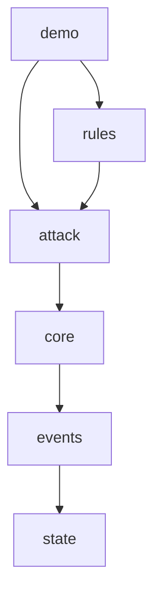

# Carte du code

## Zones

- `dnd-engine/` : le seul module Maven pour l'instant, la future librairie de règles de `solo-vtt`.
- `core/` : le moteur générique (`Engine`, `Pipeline`, `Listener`, `RuleBook`, `Decision`, `Dice`), sans aucune règle D&D.
- `state/` : l'état du jeu (`GameState`, `Creature`, armes, conditions, types de dégâts).
- `events/` : `GameEvent` (sealed), tout ce qui arrive et comment ça modifie l'état.
- `attack/` : l'action « attaque », c'est-à-dire ses phases, son contexte et les règles de base 2024.
- `rules/` : les règles optionnelles et `StandardRules`, qui assemble le `RuleBook`.
- `demo/` : démonstration console.

## Points d'entrée

- `dnd.engine.demo.Main` : la démo console (`--interactif`, `--seed=N`).
- Pour un appelant : `new Engine(state, StandardRules.create(), dice)`, puis `submit` et `answer`.
